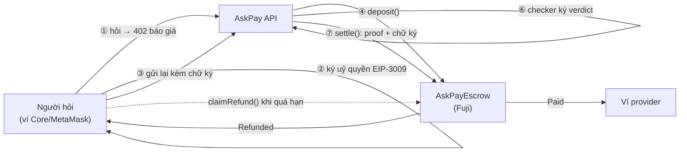

# AskPay

AI trả lời câu hỏi về **Bộ luật Lao động 2019**, **trả tiền theo từng câu qua x402** trên Avalanche. Mỗi câu trả lời phải trích Điều/Khoản. **Trích dẫn không qua kiểm tra thì hoàn tiền, và chính smart contract trả tiền lại cho bạn.**

> Team1 Vietnam UniHack 2026 · Track *Agent economy on x402* · Đề #20 · Avalanche Fuji (testnet, chain 43113)

**Bản nộp:** tag `submission-2026-11-21`. Sau tag này chỉ sửa lỗi chặn demo.

## Hệ thống chạy thế nào



**Đọc hình theo số:**

1. **Báo giá.** Lần gọi đầu tiên trả HTTP **402** kèm giá (0,05 USDC), địa chỉ escrow và mã câu hỏi `qid`.
2. **Ký.** Ví ký uỷ quyền `ReceiveWithAuthorization` (EIP-3009) với `nonce = qid`. Chưa có giao dịch nào được gửi đi.
3. **Gửi lại** câu hỏi kèm header `PAYMENT-SIGNATURE`.
4. **Giữ tiền.** Server gọi `deposit`. Escrow kéo đúng số tiền vào chính nó. Chỉ escrow dùng được chữ ký này.
5. **Trả lời.** BM25 lấy 8 Khoản liên quan. LLM viết câu trả lời và chỉ được trích trong 8 Khoản đó (server chặn mọi Khoản ngoài danh sách).
6. **Kiểm tra.** Checker (khoá riêng) kiểm đoạn trích có nằm trong nguyên văn Khoản không và Khoản có liên quan tới câu hỏi không, rồi ký kết luận.
7. **Chốt.** Contract kiểm chữ ký checker và Merkle proof của từng Khoản so với root của bộ luật đã đăng ký. Đạt thì trả cho provider; không thì **hoàn cho người hỏi**. Server im lặng quá 10 phút thì người hỏi tự rút tiền về bằng `claimRefund()`.

**Ai bảo đảm điều gì:**

| Điều được nói | Ai bảo đảm |
|---|---|
| Khoản được trích có thật trong văn bản luật đã đăng ký, nguyên văn Khoản không bị sửa | **Contract** (Merkle proof khớp root đã đăng ký) |
| Đoạn trích nằm trong nguyên văn Khoản, và Khoản liên quan tới câu hỏi | **Checker** (off-chain, ký EIP-712). Contract chỉ kiểm chữ ký |
| Trả hay hoàn tiền; tiền chỉ có hai lối ra: về người hỏi hoặc về provider | **Contract** |
| LLM không trích được Khoản ngoài danh sách tìm kiếm | **Code server** (off-chain) |

Hai điều cần nói thẳng: ở v1 checker dùng khoá riêng nhưng **do chính AskPay vận hành**, nên không phải checker độc lập; và trang `/verify` chỉ so Merkle root trong repo với root on-chain. Muốn tự kiểm đoạn trích đã duyệt, dùng `citationsHash()` trong `packages/shared` rồi đối chiếu với `citationsHash` của event `Paid` trên Snowtrace (v1 chưa có giao diện cho bước này).

## Contract trên Fuji

| | |
|---|---|
| Mạng | Avalanche Fuji (43113) |
| `AskPayEscrow` | [`0x869e95576f6dd6f06118cf733b4f307ae37ddce0`](https://testnet.snowtrace.io/address/0x869e95576f6dd6f06118cf733b4f307ae37ddce0) |
| Tx deploy | [`0xa990ec36…b6e79`](https://testnet.snowtrace.io/tx/0xa990ec3695aeda1707baaf7f9e418cdb9c042236753bc4e0e219b3c9031b6e79) (block 61046807) |
| Tx đăng ký root | [`0x889e0d0e…74b2ff`](https://testnet.snowtrace.io/tx/0x889e0d0e11ec4986fa9c114f580067138fef8612b956832388b0ef9c8d74b2ff) (`setLawRoot`) |
| Merkle root Bộ luật Lao động 2019 (`VN-45/2019/QH14`) | `0xda14ddb6540051a3538091a88a0a68bd39b2a8f4e6d218bdaf6b372dd65517a5` |
| Token | USDC Fuji [`0x5425…Bc65`](https://testnet.snowtrace.io/address/0x5425890298aed601595a70AB815c96711a31Bc65) |
| Cửa sổ trả lời | 600 giây |

Địa chỉ chép từ [`contracts/deployments/fuji.json`](contracts/deployments/fuji.json). Mã nguồn: [`contracts/src/AskPayEscrow.sol`](contracts/src/AskPayEscrow.sol).

**Tự kiểm root, không cần khoá nào** (cần [Foundry](https://book.getfoundry.sh/)):

```bash
cast call 0x869e95576f6dd6f06118cf733b4f307ae37ddce0 "lawRoot(bytes32)(bytes32)" \
  $(cast keccak "VN-45/2019/QH14") --rpc-url https://avalanche-fuji-c-chain-rpc.publicnode.com
# phải bằng nội dung packages/corpus/data/blld-2019.root.txt
```

## Câu hỏi đã chạy thật trên Fuji

Tất cả là giao dịch gọi vào contract ở trên, chạy ngày 14–20/11/2026. Lý do hoàn tiền đọc từ event `Refunded` trong receipt.

| Kết quả | Tx chốt |
|---|---|
| `Paid`, câu hỏi bình thường (chạy bằng script `e2e:ask`) | [`0x0ed41b3a…5d58d`](https://testnet.snowtrace.io/tx/0x0ed41b3a49e89d92bd9e0011ea7dedaa29bfa75ae89a45188c0dbbd84cf5d58d) |
| `Paid`, hỏi từ trình duyệt bằng ví Core | [`0xf64dba75…83323`](https://testnet.snowtrace.io/tx/0xf64dba75ae0fcc757c8eefdd8e1aea57cd014fb2a56f16b2faf5ba9588583323) |
| `Refunded`, lý do `NoCitation` (câu ngoài phạm vi, không có căn cứ) | [`0x623c4f92…0877a`](https://testnet.snowtrace.io/tx/0x623c4f92fbc64a1061a274db7c53af8f621a6bba52b22c6d9265aaaafa10877a) |
| `Refunded`, lý do `InvalidCitation` (**giả lập** server gian lận: gửi một Khoản có nội dung khác bản luật đã đăng ký, Merkle proof không khớp nên contract tự hoàn tiền dù checker ký `pass = true`) | [`0x00bfbcf3…ed4c3`](https://testnet.snowtrace.io/tx/0x00bfbcf39e9f8446f2b42f16ff73ea5aecb1fffaf571bbb7b57ee14b295ed4c3) |
| `Refunded`, lý do `Timeout`, gọi bằng `claimRefund()` | [`0xf0b3a895…46bd9`](https://testnet.snowtrace.io/tx/0xf0b3a8958315f660c24828e45505acacaabbddeedf219569ab36f9b6e4346bd9) |

## Kết quả eval

Bộ 50 câu (40 trong phạm vi Bộ luật Lao động 2019, 10 ngoài phạm vi), nhãn Điều/Khoản do owner gán và duyệt. Số chép từ [`eval/results/latest.json`](eval/results/latest.json):

| Chỉ số | Kết quả | Tính trên |
|---|---|---|
| Trích dẫn đúng Khoản | **85%** | 40 câu trong phạm vi |
| Câu đạt checker | **90%** | 40 câu trong phạm vi |
| Câu ngoài phạm vi được trả lời đúng là "không có căn cứ" | **100%** | 10 câu ngoài phạm vi |

- **Một lần chạy:** ngày 2026-11-20, commit `17b9f58`, model Groq `qwen/qwen3.8-27b`, temperature 0. LLM không tất định tuyệt đối nên chạy lại có thể lệch.
- **Về commit `17b9f58`:** đây là commit trên nhánh E1 (PR #22) trước khi squash vào `main`, nên không có trên GitHub. Mã nguồn giống `main`; chỉ khác tài liệu và file kết quả.
- **Đạt checker ≠ đúng.** Một câu trích sai Khoản nhưng đoạn trích đúng nguyên văn và Khoản "liên quan" vẫn đạt checker. Hai số đo hai thứ khác nhau, đừng gộp.
- **Điểm yếu:** nhóm "nghỉ việc" thấp nhất (50% trích đúng Khoản, 70% đạt checker); ba nhóm trong phạm vi còn lại (thử việc, làm thêm giờ, lương) đều từ 90% trở lên.
- **Giới hạn:** câu gõ **không dấu** chưa được hỗ trợ (giới hạn của retrieval BM25), nên bộ eval không có loại câu này.

## Cách chạy

**Yêu cầu:** Node 24+ (xem `.nvmrc`), [Foundry](https://book.getfoundry.sh/), Git.

```bash
git clone --recurse-submodules <repo> && cd AskPay   # contracts/lib dùng submodule
npm ci
npm run verify                      # format, lint, typecheck, Vitest, forge fmt --check, forge test. Không cần khoá
```

`npm run verify` là cách kiểm chứng **không cần khoá nào** (cần Foundry và submodule ở trên). Cùng với lệnh `cast call` ở trên và dữ liệu on-chain, đủ để kiểm contract, Merkle root và các tx nêu trong README.

**Chạy trọn luồng hỏi và trả tiền cần thứ của riêng bạn**, repo không kèm sẵn:

- Ví Fuji có AVAX (gas) và USDC Fuji (faucet.circle.com).
- Khoá provider và khoá checker. Checker phải là địa chỉ `checker` trong `fuji.json`, nên **trên contract đã deploy chỉ chủ dự án chạy được server thật**. Muốn thử đủ luồng thì deploy contract riêng lên Fuji theo [`setup-and-bringup.md`](docs/runbook/setup-and-bringup.md).
- Khoá LLM (Groq).

```bash
# apps/api/.env (mẫu: apps/api/.env.example) rồi:
npm run dev:api                     # API tại :4000
# apps/web/.env.local: API_ORIGIN=http://localhost:4000, NEXT_PUBLIC_CHAIN_ID=43113
npm run dev:web                     # web tại :3000
```

**Chạy lại eval** (`npm run eval`) gọi LLM thật, không trả tiền on-chain, cần file `.env.poc` ở thư mục gốc (gitignore) có `LLM_PROVIDER=groq`, `LLM_MODEL=qwen/qwen3.8-27b` và `LLM_API_KEY`. Lệnh ghi đè `eval/results/latest.json` trong bản clone của bạn. Chi tiết các biến môi trường và sự cố thường gặp: [`docs/runbook/setup-and-bringup.md`](docs/runbook/setup-and-bringup.md).

Không có bản chạy công khai: bằng chứng nằm ở video demo, Snowtrace, `forge test` và số eval ở trên.

## Cấu trúc repo

| Thư mục | Nội dung |
|---|---|
| `apps/api` | Express 5: x402, retrieval, LLM, checker, settle, indexer, eval |
| `apps/web` | Next.js + wagmi/viem: hỏi, kết quả, dashboard, nhận lại tiền, tự xác minh |
| `packages/shared` | Zod schema, mã lỗi kèm câu tiếng Việt, ABI, mã hoá leaf Merkle |
| `packages/corpus` | Tách Bộ luật Lao động 2019 thành Khoản, build Merkle tree |
| `contracts` | `AskPayEscrow` (Foundry) và địa chỉ đã deploy |
| `eval` | Bộ 50 câu hỏi đánh giá và kết quả |
| `docs` | Tài liệu thiết kế, viết bằng tiếng Việt |
| `plugins/sdlc` | Skill quy trình cho coding agent |

## Giới hạn đã biết

- **Mức độ liên quan do checker off-chain quyết định.** Checker và provider chạy chung một server (khác khoá), nên về lý thuyết người vận hành vẫn có thể cho một câu "liên quan yếu" qua. On-chain chỉ bảo đảm Khoản có thật trong văn bản đã đăng ký và đoạn trích hiển thị đúng là đoạn checker đã ký. Hướng đi: checker độc lập có stake, hoặc nhiều checker cùng ký.
- **Client x402 chuẩn không hiểu scheme `escrow`.** Hướng đi: đề xuất scheme lên hệ sinh thái x402, hoặc thêm chế độ `exact` không hoàn tiền.
- **Một văn bản luật, một phiên bản.** Luật sửa đổi thì root mới; câu trả lời cũ vẫn gắn với root cũ.
- **Testnet.** Chỉ chạy trên Fuji; USDC và AVAX không có giá trị thật.
- **Không phải tư vấn pháp lý.**

## Đọc tiếp

| Bạn là | Đọc |
|---|---|
| Người mới | [`docs/onboarding/concepts.md`](docs/onboarding/concepts.md) |
| Giám khảo | [`docs/product/pitch.md`](docs/product/pitch.md) |
| Người viết code | [`docs/spec/askpay-v1.md`](docs/spec/askpay-v1.md), [`docs/architecture/system-design.md`](docs/architecture/system-design.md), [`AGENTS.md`](AGENTS.md) |
| Muốn xem hết | [`docs/README.md`](docs/README.md) |

*Thông tin tham khảo, không thay thế tư vấn pháp lý.*
