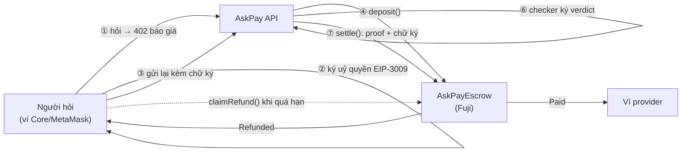

# AskPay

AI trả lời câu hỏi về **Bộ luật Lao động 2019**, **trả tiền theo từng câu qua x402** trên Avalanche. Mỗi câu trả lời phải trích nguyên văn Điều/Khoản. Smart contract tự kiểm trích dẫn bằng Merkle proof: **trích sai hoặc không trích thì tự động hoàn tiền**.

> Team1 Vietnam UniHack 2026 · Track *Agent economy on x402* · Đề #20 · Avalanche Fuji

## Hệ thống chạy thế nào

**Đọc hình theo số:**

1. **Báo giá.** Lần gọi đầu tiên trả HTTP **402** kèm giá (0,05 USDC), địa chỉ escrow và mã câu hỏi `qid`.
2. **Ký.** Ví ký uỷ quyền `ReceiveWithAuthorization` (EIP-3009) với `nonce = qid`. Chưa có giao dịch nào được gửi đi.
3. **Gửi lại** câu hỏi kèm header `PAYMENT-SIGNATURE`.
4. **Giữ tiền.** Server gọi `deposit`. Escrow kéo đúng số tiền vào chính nó. Chỉ escrow dùng được chữ ký này.
5. **Trả lời.** BM25 lấy 8 Khoản liên quan. LLM viết câu trả lời và chỉ được trích trong 8 Khoản đó.
6. **Kiểm tra.** Checker (khoá riêng) kiểm đoạn trích có đúng nguyên văn không, Khoản có liên quan không, rồi ký kết luận.
7. **Chốt.** Contract kiểm chữ ký checker và Merkle proof so với root của bộ luật đã đăng ký. Đạt thì trả cho provider; không thì **hoàn cho người hỏi**. Server im lặng quá 10 phút thì người hỏi tự rút tiền về.

**Vì sao tin được:**

- **Tiền chỉ có hai lối ra:** về người hỏi hoặc về provider. Chủ contract cũng không rút được.
- **Trích dẫn giả không qua được chain:** sửa một dấu phẩy trong nguyên văn là Merkle proof hỏng.
- **AI không có quyền với tiền:** LLM chỉ viết và chấm; ký và chuyển tiền do code và contract làm.

## Cấu trúc repo (dự kiến)

| Thư mục | Nội dung |
|---|---|
| `apps/api` | Express 5: x402, retrieval, LLM, checker, settle, indexer |
| `apps/web` | Next.js + wagmi/viem: hỏi, kết quả, dashboard, tự xác minh |
| `packages/shared` | Zod schema, mã lỗi kèm câu tiếng Việt, ABI, mã hoá leaf Merkle |
| `packages/corpus` | Tách Bộ luật Lao động 2019 thành Khoản, build Merkle tree |
| `contracts` | `AskPayEscrow` (Foundry) |
| `eval` | Bộ câu hỏi đánh giá |
| `docs` | Tài liệu thiết kế, viết bằng tiếng Việt |
| `plugins/sdlc` | Skill quy trình cho coding agent |

**Trạng thái:** đang cài đặt (15/11/2026): đã có contract trên Fuji, `apps/api` và `apps/web` (W1–W3); W4 đang làm. Cách dựng môi trường: [`docs/runbook/setup-and-bringup.md`](docs/runbook/setup-and-bringup.md).

## Đọc tiếp

| Bạn là | Đọc |
|---|---|
| Người mới | [`docs/onboarding/concepts.md`](docs/onboarding/concepts.md) |
| Giám khảo | [`docs/product/pitch.md`](docs/product/pitch.md) |
| Người viết code | [`docs/spec/askpay-v1.md`](docs/spec/askpay-v1.md), [`docs/architecture/system-design.md`](docs/architecture/system-design.md), [`AGENTS.md`](AGENTS.md) |
| Muốn xem hết | [`docs/README.md`](docs/README.md) |

*Thông tin tham khảo, không thay thế tư vấn pháp lý.*
