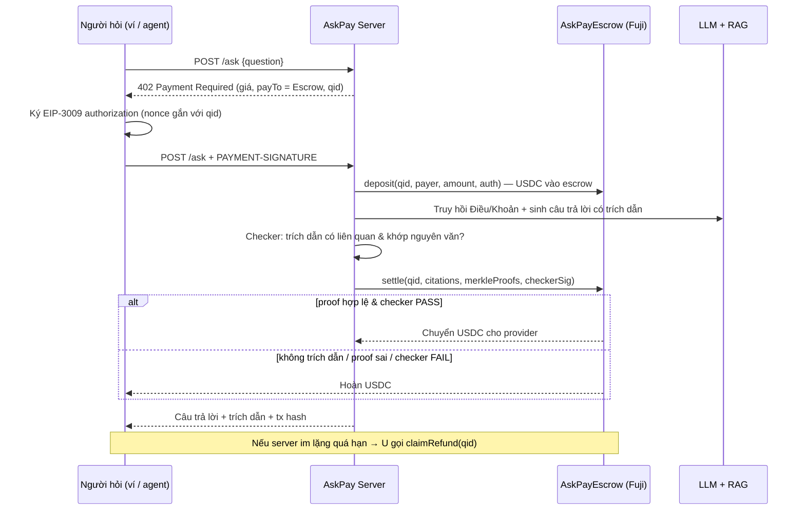

# AskPay — Kế hoạch & Kiến trúc

> Team1 Vietnam UniHack 2026 · Track **Agent economy on x402** · Đề #20 AskPay
> Hạn nộp: **23:59 21/11/2026** · Demo Day: 30/11 · Làm một mình · Stack: TypeScript + Foundry · Mạng: Avalanche Fuji

## 1. Pitch một câu

AI trả lời câu hỏi pháp luật Việt Nam, **trả tiền theo từng câu trả lời qua x402**. Mỗi câu trả lời phải trích dẫn đúng Điều/Khoản. Trích dẫn được **smart contract xác minh bằng Merkle proof**: trích sai hoặc không trích thì **tự động hoàn tiền**.

## 2. Phạm vi MVP (chốt, không mở rộng)

| Có trong MVP | Để sau (chỉ nhắc trong slide "Roadmap") |
|---|---|
| Một văn bản: **Bộ luật Lao động 2019** (45/2019/QH14) | Nhiều luật, nghị định, theo dõi văn bản hết hiệu lực |
| Fuji testnet, USDC testnet | Mainnet, L1 riêng |
| Escrow + Merkle proof + chữ ký checker | Checker phi tập trung / staking & slashing |
| Web UI hỏi–trả tiền–xem kết quả + dashboard giao dịch | App mobile |
| Bộ eval ~50 câu, có số liệu | Benchmark lớn |
| (Nếu dư thời gian) buyer-agent CLI có budget cap | Marketplace nhiều provider |

## 3. Kiến trúc

```
askpay/
├── apps/
│   ├── api/          # Express: endpoint x402, RAG, checker, settlement
│   ├── web/          # Next.js: UI hỏi đáp, ví, dashboard
│   └── agent/        # (tuỳ chọn) buyer agent dùng x402 client, có budget cap
├── packages/
│   ├── shared/       # zod schema API, mã lỗi, ABI + địa chỉ, mã hoá leaf Merkle
│   └── corpus/       # Tách luật -> Điều/Khoản JSON, build Merkle tree
├── contracts/        # Foundry: AskPayEscrow.sol + test + script deploy
├── eval/             # Bộ câu hỏi + script chấm
├── plugins/sdlc/     # Skill SDLC (xem AGENTS.md)
└── docs/             # PLAN, spec, design, conventions
```

Chi tiết từng phần ở [docs/conventions/](conventions/README.md).

### 3.1 Luồng chính



### 3.2 Vì sao không dùng facilitator công khai

Scheme `exact` chuẩn của x402 chuyển tiền **thẳng** cho `payTo`, nên không hoàn tiền được. AskPay dùng **cùng định dạng payload EIP-3009** (client x402 vẫn ký như bình thường), nhưng:

- `payTo` = địa chỉ **AskPayEscrow**.
- Server tự đóng vai facilitator: gọi `escrow.deposit(...)`. Bên trong, hàm này gọi `USDC.receiveWithAuthorization`. Hàm đó chỉ cho chính `to` (tức escrow) rút tiền, nên tránh bị front-run.
- `nonce` của authorization = `keccak256(qid, amount)` để **ràng buộc khoản trả với đúng câu hỏi**.

Ghi trong slide: *"x402-compatible, escrow-settled"*. Đây là điểm sáng tạo về kỹ thuật.

> Cần kiểm tra ngày 10/11: địa chỉ USDC trên Fuji (Circle testnet USDC, FiatTokenV2) có hỗ trợ `receiveWithAuthorization` hay không. Nếu không, phương án dự phòng là dùng `approve` + `transferFrom`, hoặc tự deploy một token ERC-20 có EIP-3009 để demo.

### 3.3 Merkle tree của văn bản luật

- **Leaf** = `keccak256(abi.encode(lawId, dieu, khoan, keccak256(bytes(nguyenVanKhoan))))`. Dùng `@openzeppelin/merkle-tree` (StandardMerkleTree), ở on-chain dùng `MerkleProof.verify` của OpenZeppelin.
- `mapping(bytes32 lawId => bytes32 root)` do owner đăng ký. Mỗi phiên bản luật có một root riêng.
- Root, JSON corpus và mã băm commit được công bố trong repo, nên ai cũng tự build lại và đối chiếu được.

**Giới hạn cần nói thẳng khi thuyết trình:** Merkle proof chứng minh trích dẫn **có thật và đúng nguyên văn**. Còn **có đúng ý câu hỏi hay không** do checker off-chain (LLM + luật) quyết định và ký. Ở MVP, khoá checker do server giữ. Roadmap: tách checker độc lập hoặc cho staking.

### 3.4 Phác thảo hợp đồng

```solidity
contract AskPayEscrow {
    enum Status { None, Open, Paid, Refunded }
    struct Question { address payer; uint96 amount; uint64 deadline; Status status; }
    struct Citation { bytes32 lawId; uint16 dieu; uint16 khoan; bytes32 textHash; }

    IERC3009 public immutable usdc;
    address public provider;
    address public checker;              // ký verdict
    uint64  public answerWindow = 10 minutes;
    mapping(bytes32 => bytes32) public lawRoot;
    mapping(bytes32 => Question) public questions;

    function deposit(bytes32 qid, address payer, uint256 amount,
                     uint256 validAfter, uint256 validBefore,
                     uint8 v, bytes32 r, bytes32 s) external;   // nonce = keccak256(qid, amount)

    function settle(bytes32 qid, bytes32 answerHash,
                    Citation[] calldata cites, bytes32[][] calldata proofs,
                    bool verdict, bytes calldata checkerSig) external;
    // cites rỗng || proof sai || verdict=false  -> Refunded
    // ngược lại                                 -> Paid

    function claimRefund(bytes32 qid) external;  // sau deadline nếu còn Open

    event Deposited(bytes32 indexed qid, address indexed payer, uint256 amount);
    event Paid(bytes32 indexed qid, bytes32 answerHash);
    event Refunded(bytes32 indexed qid, string reason);
}
```

Test Foundry tối thiểu: deposit hợp lệ; nonce sai bị từ chối; settle đúng thì chuyển cho provider; proof sai thì hoàn tiền; không có citation thì hoàn tiền; chữ ký checker giả thì revert; claimRefund trước và sau deadline; không settle hai lần.

### 3.5 Server (Express + TypeScript)

- `POST /ask`: trả 402 kèm requirements (định dạng x402 v2, header `PAYMENT-REQUIRED` / `PAYMENT-SIGNATURE`).
- **RAG:** BM25 (tiếng Việt, tách từ đơn giản) + embedding qua API, lấy top-k Khoản. LLM bắt buộc trả JSON `{answer, citations:[{dieu, khoan, quote}]}`.
- **Checker:**
  1. So khớp `quote` với nguyên văn Khoản (chuẩn hoá Unicode NFC, khoảng trắng).
  2. LLM-judge chấm mức liên quan.
  3. Ký verdict bằng EIP-712.
- **Settlement:** gọi `settle`. Lưu lịch sử (SQLite) cho dashboard.
- Không cần GPU, toàn bộ LLM gọi qua API.

### 3.6 Web (Next.js)

- Kết nối ví (Core / MetaMask) ở Fuji. Ô hỏi, hiển thị giá, ký, rồi hiện câu trả lời kèm thẻ trích dẫn (bấm vào xem nguyên văn và trạng thái "✓ verified on-chain").
- Badge **Paid / Refunded** kèm link Snowtrace.
- Trang `/dashboard`: tổng số câu hỏi, tỉ lệ hoàn tiền, doanh thu, lịch sử tx.

## 4. Lịch làm việc (một mình, 10/11 → 21/11)

| Ngày | Việc | Xong khi |
|---|---|---|
| **10/11** | Lấy văn bản BLLĐ 2019, parse ra JSON Điều/Khoản; build Merkle tree; tạo ví Fuji, xin faucet, kiểm tra USDC Fuji/EIP-3009; làm nhiệm vụ Builder Pass | `corpus/out/blld2019.json` + root |
| **11/11** | `AskPayEscrow.sol` + test Foundry | `forge test` xanh |
| **12/11** | Deploy Fuji, đăng ký root; script TS gọi deposit/settle end-to-end | 1 tx Paid + 1 tx Refunded trên Snowtrace |
| **13/11** | RAG + prompt JSON có trích dẫn | Trả lời 10 câu mẫu có trích dẫn |
| **14/11** | Checker + chữ ký EIP-712; endpoint x402 `/ask` | curl → 402 → trả → nhận answer |
| **15/11** | Gắn server với contract, settlement, lưu lịch sử | Luồng đầy đủ bằng script |
| **16/11** | Web: ví, hỏi, trả tiền, hiển thị trích dẫn | Demo được trên trình duyệt |
| **17/11** | Dashboard + xử lý lỗi + claimRefund trên UI | — |
| **18/11** | Bộ eval 50 câu + số liệu; (tuỳ chọn) buyer agent CLI | Bảng kết quả trong README |
| **19/11** | Deploy (web: Vercel; server: Render/Railway), README, đóng băng tính năng | Link public chạy được |
| **20/11** | Slide (Canva/Google Slides) + quay video 2–3 phút | — |
| **21/11** | Dự phòng; kiểm tra mọi link mở được; **nộp trước buổi tối** | Đã nộp |

**Nếu bị trễ, cắt theo thứ tự:** buyer agent → dashboard → LLM-judge (chỉ giữ so khớp nguyên văn) → BM25 (chỉ dùng embedding).

## 5. Bám tiêu chí chấm điểm

| Tiêu chí | Điểm | AskPay đáp ứng bằng |
|---|---|---|
| Kỹ thuật | 25 | Escrow + EIP-3009 + Merkle proof + EIP-712, test Foundry, bộ eval có số liệu |
| Tích hợp Avalanche | 25 | Thanh toán x402 trên Fuji, logic hoàn tiền on-chain, root luật on-chain, tx thật trong demo |
| Sáng tạo | 15 | "Trích sai thì hoàn tiền", xác minh trích dẫn bằng Merkle |
| Tác động | 15 | Sinh viên đi làm thêm / người lao động tra quyền lợi; giá vài nghìn đồng mỗi câu |
| Thuyết trình | 10 | Kịch bản demo: một câu đúng (Paid), một câu bị ép sai (Refunded) |
| UI/UX & demo | 10 | Thẻ trích dẫn có dấu "verified on-chain", link Snowtrace |

## 6. Rủi ro & cách xử lý

- **USDC Fuji không hỗ trợ EIP-3009:** dùng token demo tự deploy, hoặc approve + transferFrom (xem 3.2).
- **Parse văn bản luật lỗi định dạng:** chọn nguồn có cấu trúc rõ, kiểm tra thủ công 20 Điều đầu, chuẩn hoá NFC.
- **LLM bịa số Điều:** constrained output (chỉ cho chọn trong top-k đã truy hồi) + checker.
- **Giám khảo hỏi "server vừa là provider vừa là checker":** thừa nhận đây là giới hạn của MVP, nêu roadmap; on-chain vẫn chặn được trích dẫn bịa.
- **Disclaimer:** "Thông tin tham khảo, không thay thế tư vấn pháp lý". Ghi trong UI và slide.

## 7. Checklist nộp bài

- [ ] Repo GitHub (nếu private: thêm `tuantqse90` làm collaborator)
- [ ] Slide (Canva/Google Slides), quyền xem công khai
- [ ] Video demo 2–3 phút, quyền xem công khai
- [ ] README: cách chạy, địa chỉ contract trên Fuji, link Snowtrace, kết quả eval
- [ ] Mở thử mọi link ở chế độ ẩn danh trước khi nộp
- [ ] Hoàn thành 5 nhiệm vụ Builder Pass
