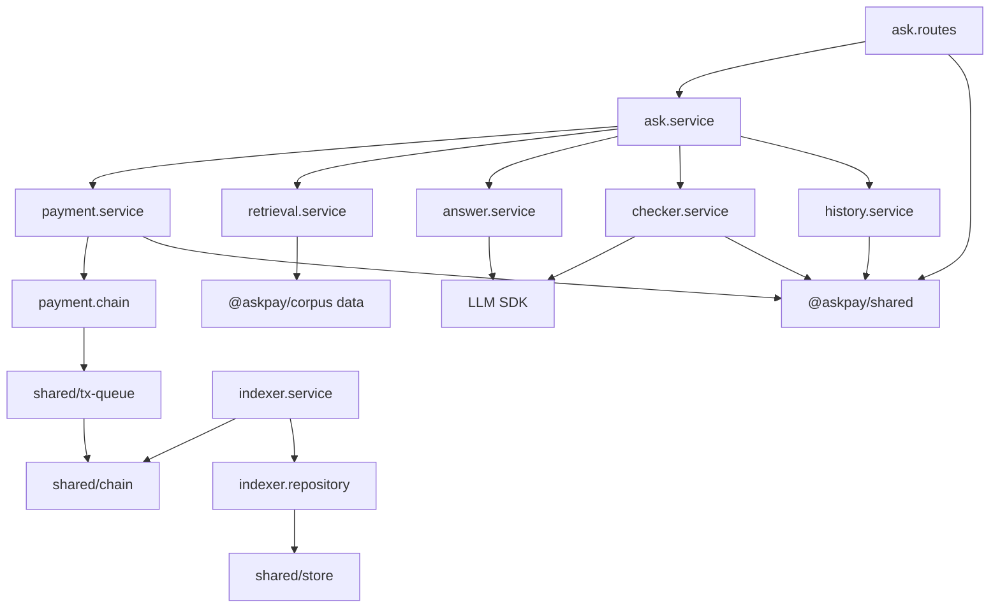

# 🧱 AskPay — Codebase Architecture

> File này mô tả cây thư mục, ranh giới module và luồng phụ thuộc. **Cách viết code** (đặt tên, lỗi, test) nằm ở [`../conventions/`](../conventions/README.md). Lý do của từng lựa chọn công nghệ nằm ở [`system-design.md` §3](./system-design.md#3-quyết-định-công-nghệ-và-đánh-đổi).
>
> **Trạng thái:** đang áp dụng (15/11/2026). Đã scaffold `contracts/`, `packages/shared`, `packages/corpus`, `apps/api` và `apps/web`; `apps/agent` (tuỳ chọn) và `eval/` chưa có.

## 1. Tóm tắt quyết định

| Câu hỏi | Trả lời |
|---|---|
| Kiến trúc | **Modular monolith**: một process API, các module chia theo tính năng |
| Repo | Monorepo npm workspaces (`apps/*`, `packages/*`) + `contracts/` (Foundry) đứng riêng |
| Backend | Express 5 + TypeScript, gom theo tính năng (`ask`, `payment`, `retrieval`, `answer`, `checker`, `history`, `indexer`) |
| Frontend | Next.js App Router + wagmi/viem + TanStack Query |
| Dùng chung | `packages/shared`: zod schema, mã lỗi kèm câu tiếng Việt, ABI, địa chỉ, mã hoá leaf Merkle, tiện ích tiền `bigint` |
| Corpus | `packages/corpus`: script và dữ liệu đã sinh (commit vào repo) |

**Vì sao không tách microservice:** làm một mình, 12 ngày, lưu lượng demo thấp. Một process, một SQLite, deploy một lần.

## 2. Cây thư mục

```
askpay/
├── apps/
│   ├── api/
│   │   ├── src/
│   │   │   ├── app.ts  server.ts
│   │   │   ├── shared/        config · logger · errors · http · chain · store · tx-queue
│   │   │   └── modules/
│   │   │       ├── ask/        ask.routes.ts · ask.service.ts
│   │   │       ├── payment/    payment.service.ts · payment.chain.ts
│   │   │       ├── retrieval/  retrieval.service.ts · bm25.ts
│   │   │       ├── answer/     answer.service.ts · answer.prompt.ts
│   │   │       ├── checker/    checker.service.ts · checker.prompt.ts
│   │   │       ├── history/    history.routes.ts · history.service.ts
│   │   │       └── indexer/    indexer.service.ts · indexer.repository.ts
│   │   ├── test/                (phản chiếu src/)
│   │   └── scripts/e2e-fuji.ts  (luồng thật trên Fuji, không nằm trong npm test)
│   ├── web/
│   │   └── src/
│   │       ├── app/             page.tsx · questions/[qid]/page.tsx · dashboard/page.tsx · verify/page.tsx
│   │       ├── features/        ask/ (gồm trang kết quả) · dashboard/ · verify/
│   │       ├── components/      ui/ · layout/ · question/ (badge, isSettled dùng chung) · wallet/
│   │       └── lib/             api.ts · wagmi.ts · format.ts · x402.ts
│   └── agent/                   (tuỳ chọn, AP-10) src/index.ts
├── packages/
│   ├── shared/src/              api.ts · errors.ts · money.ts · leaf.ts · x402.ts · abi/ · deployments.ts
│   └── corpus/
│       ├── src/                 parse.ts · normalize.ts · build-tree.ts · cli.ts
│       ├── data/                blld-2019.khoan.json · blld-2019.tree.json · blld-2019.root.txt
│       ├── raw/                 (file luật gốc do owner tải, có ghi nguồn)
│       └── test/
├── contracts/                   (Foundry, xem contracts.md)
├── eval/                        questions.json · run.ts · results/
├── docs/
└── plugins/sdlc/                (skill SDLC)
```

## 3. Ranh giới (bắt buộc)

| Luật | Vì sao |
|---|---|
| Module không import `.repository` hay `.chain` của module khác; chỉ gọi `.service` | Đổi cách lưu không lan sang module khác |
| **Chỉ `payment.chain.ts` được gửi tx.** Mọi tx đi qua `shared/tx-queue.ts` (tuần tự, T-10) | Một nơi giữ khoá provider; không trùng nonce |
| **Chỉ `checker.service.ts` được đọc khoá checker** | Tách khoá (T-04); review dễ |
| `answer` và `checker` không import `payment` | AI không chạm tới tiền (P3) |
| `apps/web` chỉ import `@askpay/shared`, không import `apps/api` | Hợp đồng duy nhất là schema |
| `packages/shared` không import gì trong `apps/` | Tránh vòng phụ thuộc |
| `leaf.ts` là **cài đặt duy nhất** của công thức leaf trong TypeScript; `packages/corpus` và `apps/api` đều gọi nó | Leaf lệch giữa hai nơi là proof hỏng ngay |

## 4. Luồng phụ thuộc giữa module



`ask.service` là nơi **duy nhất** biết thứ tự các bước (§5 của system-design). Các module khác không gọi nhau.

## 5. Lệnh gốc (sẽ thêm ở slice nền móng)

| Lệnh | Làm gì |
|---|---|
| `npm run dev` | Chạy `apps/api` và `apps/web` cùng lúc |
| `npm run corpus` | Parse luật, build Merkle tree, ghi `packages/corpus/data/` |
| `npm run abi` | `forge build` rồi sinh ABI và địa chỉ sang `packages/shared` |
| `npm run eval` | Chạy bộ eval (không trả tiền thật) |
| `npm run verify` | Format, lint, typecheck, Vitest, `forge fmt --check`, `forge test`. Đây là **định nghĩa xong**. |
| `npm run e2e:fuji` | Luồng thật trên Fuji (tốn testnet token, chạy tay) |

## 6. Test theo tầng

| Tầng | Công cụ | Giả lập gì | Ví dụ |
|---|---|---|---|
| Contract | `forge test` (unit, fuzz, invariant) | Token (`MockUSDC`) | `test_AP05_AC03_oneBadProofRefundsAll` |
| Corpus | Vitest | — | Parse đúng 220 Điều; root ổn định; leaf khớp fixture Solidity |
| Module API | Vitest | LLM, chain (ở ranh giới `.chain` và SDK) | Checker từ chối đoạn trích không có trong nguyên văn |
| Route API | Vitest + supertest | LLM, chain | `POST /ask` không có header thì trả 402 đúng định dạng |
| Web | Vitest + Testing Library | API, ví | `useAsk`: người dùng từ chối ký thì giữ nguyên câu hỏi |
| End-to-end | `scripts/e2e-fuji.ts` | Không giả lập | Paid, `NO_CITATION`, `INVALID_CITATION` trên Fuji thật |
| Chất lượng | `npm run eval` | Không chain | Tỉ lệ trích dẫn đúng |

## 7. Phân công

Làm một mình. Thứ tự làm và ngày nằm ở [`../runbook/plan.md`](../runbook/plan.md) và [`../runbook/tasks.csv`](../runbook/tasks.csv). Nếu dùng subagent, chia theo ranh giới §3 (ví dụ: một agent làm `contracts/`, một agent làm `packages/corpus`), không cho hai agent sửa cùng một file.
