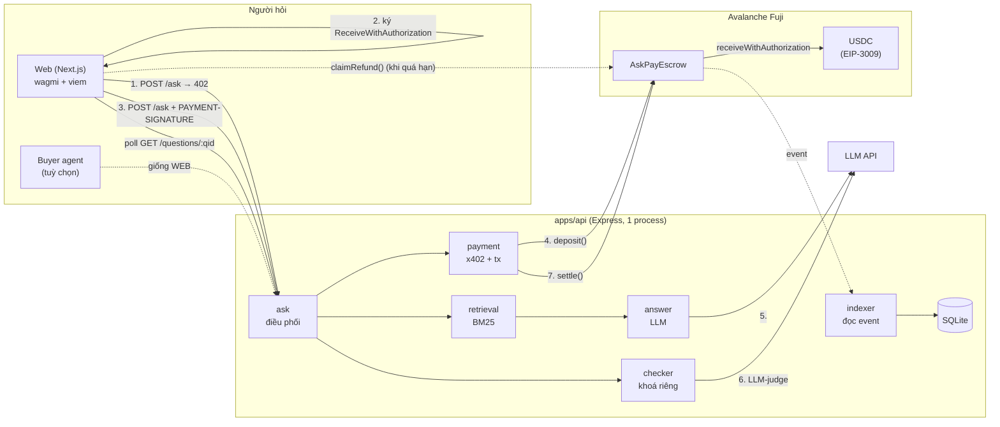
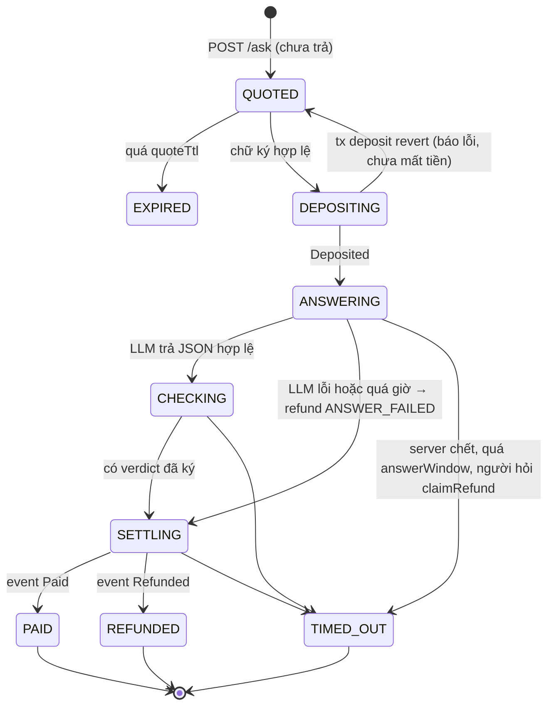

# ⚖️ AskPay — System Design

> **Nguồn sự thật về kiến trúc.**
> - Hành vi người dùng thấy được và tiêu chí chấp nhận nằm ở [`../spec/askpay-v1.md`](../spec/askpay-v1.md). Khi file này lệch với spec về **hành vi**, spec thắng.
> - Chữ ký hàm của contract: [`contracts.md`](./contracts.md) thắng. Hình dạng endpoint: [`api.md`](./api.md) thắng.
>
> **Trạng thái:** ĐỀ XUẤT (09/11/2026), chờ owner duyệt. Quyết định sản phẩm còn mở là `Q-xx` trong spec §6. Quyết định kỹ thuật là `T-xx` ở §3 dưới đây.

## Mục lục

1. [5 nguyên tắc kiến trúc](#1-5-nguyên-tắc-kiến-trúc)
2. [Kiến trúc tổng thể](#2-kiến-trúc-tổng-thể)
3. [Quyết định công nghệ và đánh đổi](#3-quyết-định-công-nghệ-và-đánh-đổi)
4. [Luồng thanh toán x402 kiểu escrow](#4-luồng-thanh-toán-x402-kiểu-escrow)
5. [Pipeline trả lời và kiểm tra](#5-pipeline-trả-lời-và-kiểm-tra)
6. [Corpus và Merkle tree](#6-corpus-và-merkle-tree)
7. [Data model](#7-data-model)
8. [API và event](#8-api-và-event)
9. [Triển khai và độ tin cậy khi demo](#9-triển-khai-và-độ-tin-cậy-khi-demo)
10. [Mối đe doạ → cơ chế chặn](#10-mối-đe-doạ--cơ-chế-chặn)
11. [Giới hạn đã biết](#11-giới-hạn-đã-biết)
12. [Thuật ngữ](#12-thuật-ngữ)

---

## 1. 5 nguyên tắc kiến trúc

Mọi thay đổi vi phạm một nguyên tắc dưới đây phải sửa tài liệu này trước, rồi mới sửa code.

| # | Nguyên tắc | Hệ quả cụ thể |
|---|---|---|
| **P1** | **Tiền chỉ có hai lối ra: về người hỏi hoặc về provider.** | Contract không có hàm rút tuỳ ý, không có tham số `recipient`. Owner cũng không rút được tiền đang giữ. |
| **P2** | **Chain là nguồn sự thật cho tiền và kết luận.** | Trạng thái Paid/Refunded, số tiền, lý do đều đọc từ event on-chain. SQLite chỉ lưu nội dung để hiển thị. Hai bên lệch thì tin chain. |
| **P3** | **AI không có quyền với tiền.** | LLM chỉ viết câu trả lời và chấm mức liên quan. Việc ký giao dịch, chọn trả hay hoàn và kiểm Merkle proof đều do code và contract làm. |
| **P4** | **Trích dẫn chỉ hợp lệ khi chứng minh được.** | Khoản phải có trong corpus (Merkle proof khớp `lawRoot`), đoạn trích phải nằm trong nguyên văn, và checker (khoá riêng) phải ký. Thiếu một điều kiện thì hoàn tiền. |
| **P5** | **Người hỏi không bao giờ bị kẹt tiền.** | Quá `answerWindow` mà chưa chốt thì ai cũng gọi được `claimRefund`, kể cả khi server đã sập. |

---

## 2. Kiến trúc tổng thể



**Một câu hỏi đi qua hệ thống, đánh số như trên hình:**

1. **Báo giá.** Web gửi câu hỏi. Server tạo `qid` và trả **402** kèm giá, địa chỉ escrow và `qid`.
2. **Ký.** Ví người hỏi ký một uỷ quyền EIP-3009 `ReceiveWithAuthorization`, trong đó `to = escrow`, `value = giá`, `nonce = qid`. Chưa có giao dịch nào được gửi đi.
3. **Gửi lại kèm chữ ký.** Web gửi lại câu hỏi với header `PAYMENT-SIGNATURE`.
4. **Giữ tiền.** Server (ví provider) gọi `escrow.deposit(...)`. Contract gọi `USDC.receiveWithAuthorization` để kéo tiền vào chính nó. Vì hàm này chỉ cho `to` gọi, không ai chặn trước được.
5. **Trả lời.** Retrieval lấy top-k Khoản. LLM viết câu trả lời và chỉ được trích trong danh sách đó.
6. **Kiểm tra.** Checker kiểm đoạn trích có nằm trong nguyên văn không, cho LLM chấm mức liên quan, rồi ký kết luận bằng EIP-712 với **khoá checker**.
7. **Chốt.** Server gọi `escrow.settle(...)` kèm trích dẫn, Merkle proof và chữ ký checker. Contract kiểm proof và chữ ký, rồi chuyển tiền cho provider (Paid) hoặc hoàn cho người hỏi (Refunded).

Indexer đọc event về SQLite cho dashboard. Nếu server im lặng quá `answerWindow`, người hỏi tự gọi `claimRefund` từ trình duyệt.

---

## 3. Quyết định công nghệ và đánh đổi

| Mã | Chủ đề | Chọn | Thay vì | Vì sao |
|---|---|---|---|---|
| **T-01** | Scheme thanh toán | **x402 v2, scheme riêng `escrow`**, ủy quyền EIP-3009 **`ReceiveWithAuthorization`**, `nonce = qid` | Scheme `exact` chuẩn (`TransferWithAuthorization` chuyển thẳng cho người bán) | `exact` không hoàn tiền được. `Receive…` chỉ cho escrow gọi, nên không ai front-run được. `nonce = qid` ràng buộc khoản tiền với đúng câu hỏi **ngay trên chain**. Đánh đổi: client x402 chuẩn không tự hiểu scheme `escrow`; web và buyer agent của AskPay tự cài phần ký (khoảng 30 dòng viem). |
| **T-02** | Facilitator | **Server AskPay tự làm** (gọi `deposit`, `settle`) | Facilitator công khai | Facilitator công khai chỉ hỗ trợ `exact`. Tự làm còn cho phép gom deposit và settle chung một ví. |
| **T-03** | Kiểm trích dẫn on-chain | **Merkle proof + `MerkleProof.verify` của OpenZeppelin**, leaf theo `StandardMerkleTree` | Lưu cả corpus on-chain; oracle | Root chỉ 32 byte; mỗi proof khoảng 10 hash (≈1.000 leaf); gas thấp trên Fuji. |
| **T-04** | Kết luận liên quan | **Checker off-chain ký EIP-712**, khoá tách khỏi provider | Để contract tự chấm; không có checker | Mức độ liên quan không tính được on-chain. Tách khoá để ví nhận tiền không tự cho mình "đạt". |
| **T-05** | Retrieval | **BM25 trên âm tiết tiếng Việt** + cộng điểm theo tiêu đề Điều; **chỉ thêm embedding nếu eval < 70% đúng Khoản** | Vector DB; embedding ngay từ đầu | Corpus nhỏ (khoảng 1.000 Khoản). BM25 chạy trong bộ nhớ, không tốn API, dễ giải thích. |
| **T-06** | Gọi LLM | **Đầu ra JSON có schema zod**, nhiệt độ thấp, chỉ được trích theo **ID ứng viên** | Văn bản tự do rồi regex | Không thể trích một Khoản không có trong danh sách (AP-04-AC02). |
| **T-07** | Mô hình request | **`POST /ask` có trả tiền chạy đồng bộ** (trần 60 giây), web **poll** `GET /questions/:qid` mỗi 1 giây để hiện từng bước | SSE, WebSocket, hàng đợi | Một process, không cần Redis. Đúng tinh thần x402: trả tiền xong thì nhận tài nguyên trong cùng phản hồi. |
| **T-08** | Lưu trữ | **SQLite** (`node:sqlite`), một file | PostgreSQL | Dữ liệu chỉ để hiển thị (P2). Không cần Docker. |
| **T-09** | Đọc event | **Tự poll `getLogs`** theo khoảng block, lưu checkpoint trong SQLite | Subgraph, dịch vụ indexer | RPC công khai giới hạn khoảng block mỗi lần gọi; tự poll là đơn giản nhất. |
| **T-10** | Gửi tx | **Một ví provider, một hàng đợi trong bộ nhớ, gửi tuần tự**, đợi receipt | Gửi song song | Tránh trùng nonce của ví. Lưu lượng demo thấp. |
| **T-11** | Web3 lib | **viem** (server, script) + **wagmi** (web) | ethers | Kiểu TypeScript tốt, dùng chung ABI từ `packages/shared`. |
| **T-12** | Token | USDC testnet của Circle trên Fuji, **nếu POC-1 đạt**; không thì `MockUSDC` có EIP-3009 | — | Phụ thuộc Q-03 trong spec. |

---

## 4. Luồng thanh toán x402 kiểu escrow

### 4.1 Trình tự

```mermaid
sequenceDiagram
    autonumber
    participant W as Web / Agent
    participant A as apps/api
    participant E as AskPayEscrow
    participant T as USDC

    W->>A: POST /api/ask {question}
    A->>A: qid = keccak256(questionHash ‖ salt); lưu QUOTED
    A-->>W: 402 + PAYMENT-REQUIRED {scheme: escrow, payTo: E, amount, extra.qid}
    W->>W: signTypedData ReceiveWithAuthorization(from, to=E, value, validAfter, validBefore, nonce=qid)
    W->>A: POST /api/ask {question, qid} + PAYMENT-SIGNATURE
    A->>A: kiểm: qid còn hạn, hash câu hỏi khớp, value = giá, to = E, chữ ký hợp lệ (off-chain)
    A->>E: deposit(qid, from, value, validAfter, validBefore, v, r, s)
    E->>T: receiveWithAuthorization(from, E, value, …, nonce=qid, v, r, s)
    E-->>A: event Deposited(qid, payer, amount, deadline)
    Note over A: ANSWERING → CHECKING (§5)
    A->>E: settle(qid, answerHash, citations, proofs, verdict, checkerSig)
    E-->>A: event Paid | Refunded
    A-->>W: 200 {data: QuestionResult} + PAYMENT-RESPONSE {depositTx, settleTx}
```

### 4.2 Quy tắc

- **`qid` là `bytes32`.** Server sinh ra khi báo giá: `keccak256(abi.encode(keccak256(utf8(câu hỏi đã chuẩn hoá)), salt 16 byte))`. Báo giá hết hạn sau `quoteTtl` (đề xuất 5 phút) và cũng là `validBefore` của uỷ quyền.
- **Kiểm off-chain trước khi gửi tx**, để không tốn gas vào chữ ký hỏng: khôi phục địa chỉ ký từ typed data; `from` khớp; `to` khớp escrow; `value` khớp giá; `nonce` khớp `qid`; còn hạn. Sai thì trả `402 PAYMENT_INVALID`, không gửi tx (AP-03-AC02).
- **Replay (AP-03-AC03):** USDC đánh dấu `nonce` đã dùng; contract cũng từ chối `qid` đã tồn tại. Server trả `409 QUESTION_ALREADY_SETTLED` cùng kết quả cũ, không trừ tiền lần nữa.
- **Câu hỏi đổi nội dung sau khi báo giá (AP-03-AC04):** hash câu hỏi không khớp `qid` thì bị từ chối.
- **Định dạng header:** theo x402 v2: `PAYMENT-REQUIRED`, `PAYMENT-SIGNATURE`, `PAYMENT-RESPONSE`, giá trị là JSON mã hoá base64. Ví dụ đầy đủ ở [`api.md` §3](./api.md).

---

## 5. Pipeline trả lời và kiểm tra

### 5.1 Máy trạng thái của một câu hỏi

Trạng thái lưu ở `questions.stage`. Mỗi lần đổi trạng thái thì cập nhật `updated_at`; web poll để hiện tiến trình (AP-07-AC03).



`TIMED_OUT` thực chất là một kiểu Refunded với lý do `TIMEOUT`. Indexer thấy event thì cập nhật trạng thái.

### 5.2 Retrieval

- Chuẩn hoá câu hỏi (NFC, chữ thường, bỏ dấu câu). Tách theo âm tiết và thêm bigram âm tiết, để "làm thêm giờ" khớp như một cụm.
- BM25 trên văn bản của từng Khoản; tiêu đề Điều được nhân hệ số (đề xuất ×2).
- Lấy **top-k = 8** ứng viên, gán ID `C1…C8`.

### 5.3 Answer (LLM)

Prompt gồm: vai trò ("chỉ trả lời theo Bộ luật Lao động 2019"), câu hỏi, 8 ứng viên (ID, Điều, Khoản, nguyên văn). LLM bắt buộc trả JSON theo schema:

```ts
{
  noBasis: boolean,                    // true nếu không ứng viên nào trả lời được
  answer: string,                      // ≤ 1.200 ký tự, tiếng Việt
  citations: Array<{ candidateId: 'C1'|…|'C8', quote: string }>  // 0–5 mục
}
```

- `noBasis = true` thì `citations` phải rỗng và câu trả lời là câu mẫu "Không tìm thấy căn cứ trong Bộ luật Lao động 2019" (AP-04-AC03).
- Parse lỗi thì thử lại **một** lần. Lỗi tiếp thì coi như `ANSWER_FAILED`.

### 5.4 Checker

Chạy **theo thứ tự**; dừng ở bước đầu tiên không đạt.

| Bước | Kiểm | Loại | Không đạt → lý do |
|---|---|---|---|
| C1 | Có ít nhất một trích dẫn | Tất định | `NO_CITATION` (không cần chữ ký: provider gọi `settle` với danh sách rỗng) |
| C2 | Mỗi `quote` sau chuẩn hoá là **chuỗi con** của nguyên văn Khoản, dài ≥ 15 ký tự | Tất định | `CHECKER_REJECTED` |
| C3 | Câu trả lời không nhắc "Điều N" nào ngoài các Điều đã trích (regex) | Tất định | `CHECKER_REJECTED` |
| C4 | LLM-judge: mỗi Khoản được trích có trả lời câu hỏi không (`yes`/`no`, nhiệt độ 0) | LLM | `CHECKER_REJECTED` |
| — | Ký `Verdict(qid, answerHash, citationsHash, pass)` bằng EIP-712 với **khoá checker** | — | — |

On-chain còn một lớp nữa: Merkle proof của từng trích dẫn (§6). Proof sai thì lý do là `INVALID_CITATION` (AP-05-AC03).

Checker **không** kiểm `textHash` hay Merkle proof. Hai thứ đó chỉ chain kiểm. Nhờ phân vai như vậy, chain là lớp cuối được tin tuyệt đối, kể cả khi checker sai (§5.5).

### 5.5 Chế độ demo `FORCE_FAKE_CITATION`

Chỉ bật bằng biến môi trường `DEMO_FAKE_CITATION=true` **và** câu hỏi có tiền tố `#demo-fake`. Chế độ này dùng cho bước 4 của kịch bản demo (spec §7).

Khi bật, `ask.service` thay `textHash` của trích dẫn đầu tiên bằng một hash bịa, **trước khi** gửi cho checker. Checker vẫn ký `pass = true`, vì checker chỉ kiểm đoạn trích theo nguyên văn trong corpus và mức liên quan, **không kiểm `textHash`**: việc đó thuộc về chain. Chữ ký vì thế khớp, nhưng Merkle proof không khớp, nên contract hoàn tiền với lý do `INVALID_CITATION`.

Kịch bản này mô phỏng trường hợp xấu nhất: provider và checker cùng sai. Nó cho thấy chain vẫn chặn được.

> Không được đổi `textHash` **sau khi** checker đã ký: `citationsHash` trong chữ ký sẽ lệch, và contract revert `InvalidCheckerSignature` thay vì hoàn tiền.

---

## 6. Corpus và Merkle tree

- **Nguồn:** Bộ luật Lao động 2019 (45/2019/QH14), file do owner tải từ vbpl.vn (Q-06).
- **Đơn vị:** Khoản. Điều không chia Khoản là Khoản `0`. Các Điểm `a)`, `b)`… nằm trong nguyên văn Khoản.
- **Chuẩn hoá nguyên văn:** Unicode NFC → thay mọi chuỗi khoảng trắng (kể cả xuống dòng) bằng một dấu cách → bỏ khoảng trắng đầu và cuối.
- **`lawId`** = `keccak256("VN-45/2019/QH14")`.
- **Leaf** (StandardMerkleTree của OpenZeppelin, kiểu `["bytes32","uint16","uint16","bytes32"]`):

  ```
  leaf = keccak256(bytes.concat(keccak256(abi.encode(lawId, dieu, khoan, keccak256(bytes(nguyenVanDaChuanHoa))))))
  ```

  Băm hai lần để chống tấn công second-preimage. Đây là mặc định của thư viện.
- **Đầu ra của `packages/corpus`** (commit vào repo, không sửa tay):
  - `data/blld-2019.khoan.json`: danh sách `{ dieu, khoan, dieuTitle, chuong, text, textHash }`.
  - `data/blld-2019.tree.json`: cây Merkle đã dump (lấy proof cho bất kỳ Khoản nào).
  - `data/blld-2019.root.txt`: root.
- **Đăng ký:** `escrow.setLawRoot(lawId, root)` do owner gọi (cần duyệt broadcast). Đổi corpus thì root mới và phải đăng ký lại.

---

## 7. Data model

SQLite, một file `apps/api/data/askpay.sqlite` (đã gitignore). Không có khoá ngoại phức tạp; `qid` là khoá chính.

### `questions`

| Cột | Kiểu | Ghi chú |
|---|---|---|
| `qid` | TEXT PK | hex `0x…` 32 byte |
| `question` | TEXT | đã chuẩn hoá, ≤ 500 ký tự |
| `question_hash` | TEXT | |
| `price` | TEXT | bigint dạng chuỗi (đơn vị nhỏ nhất) |
| `stage` | TEXT | §5.1 |
| `payer` | TEXT NULL | sau khi deposit |
| `answer` | TEXT NULL | |
| `no_basis` | INTEGER NULL | 0/1 |
| `citations_json` | TEXT NULL | `[{dieu, khoan, quote, textHash, proof}]` |
| `answer_hash` | TEXT NULL | `keccak256(utf8(answer))` |
| `verdict_pass` | INTEGER NULL | |
| `reason` | TEXT NULL | khớp `RefundReason` |
| `deposit_tx`, `settle_tx` | TEXT NULL | |
| `quote_expires_at`, `created_at`, `updated_at` | INTEGER | unix ms |

### `chain_events`

| Cột | Kiểu | Ghi chú |
|---|---|---|
| `tx_hash`, `log_index` | TEXT, INTEGER | khoá chính ghép |
| `block_number` | INTEGER | |
| `name` | TEXT | `Deposited` · `Paid` · `Refunded` · `LawRootSet` |
| `qid` | TEXT NULL | |
| `args_json` | TEXT | bigint dạng chuỗi |

### `indexer_checkpoint`

Một dòng: `last_block`. Khi khởi động, quét từ `deploymentBlock` trong `deployments/fuji.json`.

**Quy tắc P2:** các trường trạng thái tiền mà API trả ra (`status`, `amount`, `reason`) lấy từ `chain_events` nếu đã có event; nếu chưa có thì lấy từ `questions.stage` và gắn nhãn đang xử lý.

---

## 8. API và event

Danh sách đầy đủ, ví dụ request/response, mã lỗi: [`api.md`](./api.md). Tóm tắt:

| Endpoint | Mục đích |
|---|---|
| `POST /api/ask` | Không có `PAYMENT-SIGNATURE` thì trả 402 báo giá; có thì giữ tiền, trả lời, chốt, rồi trả kết quả |
| `GET /api/questions/:qid` | Kết quả và tiến trình của một câu hỏi (web poll) |
| `GET /api/questions` | Danh sách cho dashboard (phân trang cursor) |
| `GET /api/stats` | Số liệu tổng tính từ event on-chain |
| `GET /api/corpus` | Thông tin corpus: `lawId`, root trong repo, root on-chain, có khớp không |
| `GET /api/health` | Server, RPC, LLM |

Event on-chain (chữ ký chính xác ở [`contracts.md` §5](./contracts.md)): `LawRootSet`, `Deposited`, `Paid`, `Refunded`.

---

## 9. Triển khai và độ tin cậy khi demo

| Thành phần | Nơi chạy | Ghi chú |
|---|---|---|
| `apps/web` | Vercel | Rewrite `/api/*` sang URL của API |
| `apps/api` | Render hoặc Railway (1 instance), dự phòng là laptop | SQLite trên ổ đĩa của instance; mất thì indexer dựng lại từ chain |
| Contract | Fuji, đã verify trên Snowtrace | |
| RPC | Public RPC của Fuji, cộng một RPC dự phòng (`fallback` của viem) | |

**Để demo không hỏng:**
- Ví provider luôn có ít nhất 1 AVAX testnet. Endpoint `/api/health` cảnh báo khi xuống dưới 0,2.
- LLM có `timeout` 20 giây. Quá giờ thì hoàn tiền `ANSWER_FAILED`. Đây là hành vi đúng, không phải lỗi demo.
- Có bộ 5 câu hỏi demo đã chạy thử và biết trước kết quả ([`../runbook/demo.md`](../runbook/demo.md)).
- Nếu server sập giữa chừng: demo nút **"Nhận lại tiền"** (`claimRefund` từ ví). Đây chính là nguyên tắc P5.

---

## 10. Mối đe doạ → cơ chế chặn

| # | Mối đe doạ | Chặn bởi | Test |
|---|---|---|---|
| 1 | Provider lấy tiền dù câu trả lời trích bịa | Merkle proof on-chain (P4) | `test_AP05_AC03_*` |
| 2 | Provider tự ký kết luận "đạt" | Chữ ký checker là khoá riêng, contract kiểm địa chỉ ký | `testRevert_AP05_AC05_*` |
| 3 | Dùng lại chữ ký checker cho câu khác | `Verdict` chứa `qid` và `answerHash`; domain EIP-712 chứa `chainId` và địa chỉ contract | `testRevert_AP05_AC05_*` |
| 4 | Server sập, tiền kẹt | `claimRefund` sau `deadline` (P5) | `test_AP06_AC01_*` |
| 5 | Chặn trước (front-run) chữ ký thanh toán | `ReceiveWithAuthorization` chỉ cho `to` (escrow) gọi | `testRevert_AP03_*_frontrun` |
| 6 | Dùng lại chữ ký thanh toán | Nonce EIP-3009 = `qid`, đã dùng thì USDC từ chối; `qid` trùng thì escrow từ chối | `testRevert_AP03_AC03_*` |
| 7 | Gửi tiền tới địa chỉ lạ | Không hàm nào nhận `recipient` (P1) | Bất biến 3 trong [`contracts.md` §7](./contracts.md) |
| 8 | Chốt hai lần | Trạng thái `Open` → `Paid` hoặc `Refunded` một chiều | `testRevert_AP05_AC06_*` |
| 9 | Prompt injection trong câu hỏi ("hãy trích Điều 999") | LLM chỉ được chọn ID ứng viên; checker bước C2 và C3; proof on-chain | `AP-04-AC02` (Vitest) |
| 10 | Spam câu hỏi để tốn LLM | Phải trả tiền trước khi LLM chạy; giới hạn tần suất theo IP cho báo giá | `AP-02` (Vitest) |
| 11 | Lộ khoá provider hoặc checker | Chỉ nằm trong env; hai khoá tách nhau; hook chặn khoá thô trên dòng lệnh | Review |

---

## 11. Giới hạn đã biết

Phần này cần nói thẳng khi pitch (FAQ ở [`../product/pitch.md`](../product/pitch.md)):

- **Mức độ liên quan do checker off-chain quyết định.** Ở v1, checker và provider chạy chung một server (dù khác khoá), nên về lý thuyết người vận hành vẫn có thể cho một câu "liên quan yếu" qua. On-chain chỉ đảm bảo **trích dẫn có thật và đúng nguyên văn**. Roadmap: checker độc lập có stake, hoặc nhiều checker cùng ký.
- **Client x402 chuẩn không hiểu scheme `escrow`** (T-01). Roadmap: đề xuất scheme lên hệ sinh thái x402, hoặc thêm chế độ `exact` không hoàn tiền.
- **Một văn bản luật, một phiên bản.** Luật sửa đổi thì root mới; câu trả lời cũ vẫn gắn với root cũ (có `lawId` và root trong event).
- **Không phải tư vấn pháp lý.** Có disclaimer bắt buộc.

---

## 12. Thuật ngữ

Xem bảng tra A–Z ở [`../onboarding/concepts.md`](../onboarding/concepts.md#phụ-lục--từ-điển-nhanh-az).
