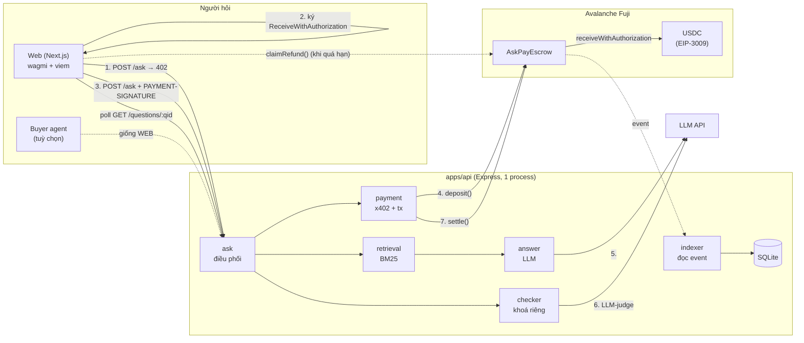
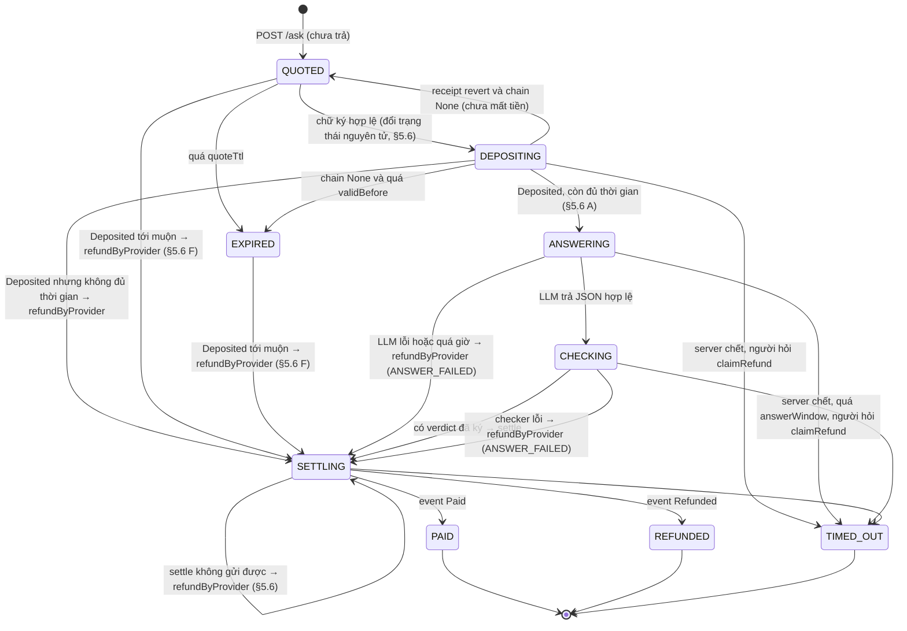

# ⚖️ AskPay — System Design

> **Nguồn sự thật về kiến trúc.**
> - Hành vi người dùng thấy được và tiêu chí chấp nhận nằm ở [`../spec/askpay-v1.md`](../spec/askpay-v1.md). Khi file này lệch với spec về **hành vi**, spec thắng.
> - Chữ ký hàm của contract: [`contracts.md`](./contracts.md) thắng. Hình dạng endpoint: [`api.md`](./api.md) thắng.
>
> **Trạng thái:** ĐANG ÁP DỤNG (15/11/2026): owner đã chốt các quyết định kỹ thuật và duyệt từng slice; mã A1–W3 đã được viết theo tài liệu này. Quyết định sản phẩm là `Q-xx` trong spec §6 (đã chốt hết; Q-08 chốt 20/11/2026). Quyết định kỹ thuật là `T-xx` ở §3 dưới đây.

## Mục lục

1. [5 nguyên tắc kiến trúc](#1-5-nguyên-tắc-kiến-trúc)
2. [Kiến trúc tổng thể](#2-kiến-trúc-tổng-thể)
3. [Quyết định công nghệ và đánh đổi](#3-quyết-định-công-nghệ-và-đánh-đổi)
4. [Luồng thanh toán x402 kiểu escrow](#4-luồng-thanh-toán-x402-kiểu-escrow)
5. [Pipeline trả lời và kiểm tra](#5-pipeline-trả-lời-và-kiểm-tra)
6. [Corpus và Merkle tree](#6-corpus-và-merkle-tree)
7. [Data model](#7-data-model)
8. [API và event](#8-api-và-event)
9. [Triển khai và độ tin cậy khi demo](#9-triển-khai-và-độ-tin-cậy-khi-demo)
10. [Mối đe doạ → cơ chế chặn](#10-mối-đe-doạ--cơ-chế-chặn)
11. [Giới hạn đã biết](#11-giới-hạn-đã-biết)
12. [Thuật ngữ](#12-thuật-ngữ)

---

## 1. 5 nguyên tắc kiến trúc

Mọi thay đổi vi phạm một nguyên tắc dưới đây phải sửa tài liệu này trước, rồi mới sửa code.

| # | Nguyên tắc | Hệ quả cụ thể |
|---|---|---|
| **P1** | **Tiền chỉ có hai lối ra: về người hỏi hoặc về provider.** | Contract không có hàm rút tuỳ ý, không có tham số `recipient`. Owner cũng không rút được tiền đang giữ. |
| **P2** | **Chain là nguồn sự thật cho tiền và kết luận.** | Trạng thái Paid/Refunded, số tiền, lý do đều đọc từ event on-chain. SQLite chỉ lưu nội dung để hiển thị. Hai bên lệch thì tin chain. |
| **P3** | **AI không có quyền với tiền.** | LLM chỉ viết câu trả lời và chấm mức liên quan. Việc ký giao dịch, chọn trả hay hoàn và kiểm Merkle proof đều do code và contract làm. |
| **P4** | **Trích dẫn chỉ hợp lệ khi chứng minh được.** | Khoản phải có trong corpus (Merkle proof khớp `lawRoot`), đoạn trích phải nằm trong nguyên văn, và checker (khoá riêng) phải ký. Thiếu một điều kiện thì hoàn tiền. |
| **P5** | **Người hỏi không bao giờ bị kẹt tiền.** | Quá `answerWindow` mà chưa chốt thì ai cũng gọi được `claimRefund`, kể cả khi server đã sập. |

---

## 2. Kiến trúc tổng thể



**Một câu hỏi đi qua hệ thống, đánh số như trên hình:**

1. **Báo giá.** Web gửi câu hỏi. Server tạo `qid` và trả **402** kèm giá, địa chỉ escrow và `qid`.
2. **Ký.** Ví người hỏi ký một uỷ quyền EIP-3009 `ReceiveWithAuthorization`, trong đó `to = escrow`, `value = giá`, `nonce = qid`. Chưa có giao dịch nào được gửi đi.
3. **Gửi lại kèm chữ ký.** Web gửi lại câu hỏi với header `PAYMENT-SIGNATURE`.
4. **Giữ tiền.** Server (ví provider) gọi `escrow.deposit(...)`. Contract gọi `USDC.receiveWithAuthorization` để kéo tiền vào chính nó. Vì hàm này chỉ cho `to` gọi, không ai chặn trước được.
5. **Trả lời.** Retrieval lấy top-k Khoản. LLM viết câu trả lời và chỉ được trích trong danh sách đó.
6. **Kiểm tra.** Checker kiểm đoạn trích có nằm trong nguyên văn không, cho LLM chấm mức liên quan, rồi ký kết luận bằng EIP-712 với **khoá checker**.
7. **Chốt.** Server gọi `escrow.settle(...)` kèm trích dẫn, Merkle proof và chữ ký checker. Contract kiểm proof và chữ ký, rồi chuyển tiền cho provider (Paid) hoặc hoàn cho người hỏi (Refunded).

Indexer đọc event về SQLite cho dashboard. Nếu server im lặng quá `answerWindow`, người hỏi tự gọi `claimRefund` từ trình duyệt.

---

## 3. Quyết định công nghệ và đánh đổi

| Mã | Chủ đề | Chọn | Thay vì | Vì sao |
|---|---|---|---|---|
| **T-01** | Scheme thanh toán | **x402 v2, scheme riêng `escrow`**, ủy quyền EIP-3009 **`ReceiveWithAuthorization`**, `nonce = qid` | Scheme `exact` chuẩn (`TransferWithAuthorization` chuyển thẳng cho người bán) | `exact` không hoàn tiền được. `Receive…` chỉ cho escrow gọi, nên không ai front-run được. `nonce = qid` ràng buộc khoản tiền với đúng câu hỏi **ngay trên chain**. Đánh đổi: client x402 chuẩn không tự hiểu scheme `escrow`; web và buyer agent của AskPay tự cài phần ký (khoảng 30 dòng viem). |
| **T-02** | Facilitator | **Server AskPay tự làm** (gọi `deposit`, `settle`) | Facilitator công khai | Facilitator công khai chỉ hỗ trợ `exact`. Tự làm còn cho phép gom deposit và settle chung một ví. |
| **T-03** | Kiểm trích dẫn on-chain | **Merkle proof + `MerkleProof.verify` của OpenZeppelin**, leaf theo `StandardMerkleTree` | Lưu cả corpus on-chain; oracle | Root chỉ 32 byte; mỗi proof khoảng 10 hash (≈1.000 leaf); gas thấp trên Fuji. |
| **T-04** | Kết luận liên quan | **Checker off-chain ký EIP-712**, khoá tách khỏi provider | Để contract tự chấm; không có checker | Mức độ liên quan không tính được on-chain. Tách khoá để ví nhận tiền không tự cho mình "đạt". |
| **T-05** | Retrieval | **BM25 trên âm tiết tiếng Việt** + cộng điểm theo tiêu đề Điều; **chỉ thêm embedding nếu eval < 70% đúng Khoản** | Vector DB; embedding ngay từ đầu | Corpus nhỏ (khoảng 1.000 Khoản). BM25 chạy trong bộ nhớ, không tốn API, dễ giải thích. |
| **T-06** | Gọi LLM | **Đầu ra JSON có schema zod**, nhiệt độ thấp, chỉ được trích theo **ID ứng viên** | Văn bản tự do rồi regex | Không thể trích một Khoản không có trong danh sách (AP-04-AC02). |
| **T-07** | Mô hình request | **`POST /ask` có trả tiền chạy đồng bộ** (trần 60 giây), web **poll** `GET /questions/:qid` mỗi 1 giây để hiện từng bước | SSE, WebSocket, hàng đợi | Một process, không cần Redis. Đúng tinh thần x402: trả tiền xong thì nhận tài nguyên trong cùng phản hồi. |
| **T-08** | Lưu trữ | **SQLite** (`node:sqlite`), một file | PostgreSQL | Dữ liệu chỉ để hiển thị (P2). Không cần Docker. |
| **T-09** | Đọc event | **Tự poll `getLogs`** theo khoảng block, lưu checkpoint trong SQLite | Subgraph, dịch vụ indexer | RPC công khai giới hạn khoảng block mỗi lần gọi; tự poll là đơn giản nhất. |
| **T-10** | Gửi tx | **Một ví provider, một hàng đợi trong bộ nhớ, gửi tuần tự**, đợi receipt | Gửi song song | Tránh trùng nonce của ví. Lưu lượng demo thấp. |
| **T-11** | Web3 lib | **viem** (server, script) + **wagmi** (web) | ethers | Kiểu TypeScript tốt, dùng chung ABI từ `packages/shared`. |
| **T-12** | Token | **USDC testnet của Circle trên Fuji** (`0x5425890298aed601595a70AB815c96711a31Bc65`, `name` "USD Coin", `version` "2"). `MockUSDC` chỉ dùng trong test. *(POC-1 đạt 14/11/2026, xem [poc-results](../research/poc-results.md))* | `MockUSDC` có EIP-3009 (phương án dự phòng nếu USDC Fuji hỏng) | Phụ thuộc Q-03 trong spec. |
| **T-13** | Cam kết đoạn trích *(owner duyệt 14/11/2026, spec Q-09)* | **Thêm `quoteHash` vào `Citation`.** Hash này nằm trong `citationsHash` mà checker ký và được phát lại trong event `Paid`. Leaf Merkle giữ nguyên ([contracts §4.4](./contracts.md)). | (a) Offset `(start, len)` của đoạn trích trong nguyên văn; (b) đưa nguyên văn đoạn trích vào event | Chỉ thêm 32 byte mỗi trích dẫn, không đổi root, và TS dễ khớp với Solidity. (a) cho người ngoài tự kiểm "chuỗi con" mà không cần tin checker, nhưng offset byte UTF-8 trên tiếng Việt có dấu dễ lệch giữa TS và Solidity. Để dành làm roadmap. (b) tốn gas theo độ dài đoạn trích, mà hash đã đủ để đối chiếu. |
| **T-14** | Lưu SQLite khi deploy *(owner duyệt 14/11/2026, spec Q-12)* | **Ổ đĩa lưu bền** gắn vào instance API: Render disk hoặc volume của Railway | (a) Ổ đĩa tạm của instance; (b) cấm deploy trước Demo Day rồi chạy lại câu demo | (a) mỗi lần deploy xoá sạch nội dung câu hỏi và câu trả lời, nên trang `/questions/:qid` của câu demo chuẩn bị sẵn sẽ trống. (b) dễ quên và cấm sửa lỗi phút chót. Đánh đổi: ổ đĩa lưu bền thường cần gói trả phí, và instance có ổ đĩa không deploy kiểu không gián đoạn; kiểm lại giá khi tạo. |

---

## 4. Luồng thanh toán x402 kiểu escrow

### 4.1 Trình tự

```mermaid
sequenceDiagram
    autonumber
    participant W as Web / Agent
    participant A as apps/api
    participant E as AskPayEscrow
    participant T as USDC

    W->>A: POST /api/ask {question}
    A->>A: qid = keccak256(questionHash ‖ salt); lưu QUOTED
    A-->>W: 402 + PAYMENT-REQUIRED {scheme: escrow, payTo: E, amount, extra.qid}
    W->>W: signTypedData ReceiveWithAuthorization(from, to=E, value, validAfter, validBefore, nonce=qid)
    W->>A: POST /api/ask {question, qid} + PAYMENT-SIGNATURE
    A->>A: kiểm: qid còn hạn, hash câu hỏi khớp, value = giá, to = E, chữ ký hợp lệ (off-chain)
    A->>E: deposit(qid, from, value, validAfter, validBefore, v, r, s)
    E->>T: receiveWithAuthorization(from, E, value, …, nonce=qid, v, r, s)
    E-->>A: event Deposited(qid, payer, amount, deadline)
    Note over A: ANSWERING → CHECKING (§5)
    A->>E: settle(qid, answerHash, citations, proofs, pass, checkerSig)
    E-->>A: event Paid(…, answerHash, citationsHash) | Refunded
    A-->>W: 200 {data: QuestionResult} + PAYMENT-RESPONSE {depositTx, settleTx}
```

### 4.2 Quy tắc

- **`qid` là `bytes32`.** Server sinh ra khi báo giá: `keccak256(abi.encode(keccak256(utf8(câu hỏi đã chuẩn hoá)), salt 16 byte))`. Báo giá hết hạn sau `quoteTtl` (đề xuất 5 phút) và cũng là `validBefore` của uỷ quyền.
- **Kiểm off-chain trước khi gửi tx**, để không tốn gas vào chữ ký hỏng: khôi phục địa chỉ ký từ typed data; `from` khớp; `to` khớp escrow; `value` khớp giá; `nonce` khớp `qid`; còn hạn. Sai thì trả `402 PAYMENT_INVALID`, không gửi tx (AP-03-AC02).
- **Replay (AP-03-AC03):** USDC đánh dấu `nonce` đã dùng; contract cũng từ chối `qid` đã tồn tại. Server trả `409 QUESTION_ALREADY_SETTLED` cùng kết quả cũ, không trừ tiền lần nữa.
- **Câu hỏi đổi nội dung sau khi báo giá (AP-03-AC04):** hash câu hỏi không khớp `qid` thì bị từ chối.
- **Định dạng header:** theo x402 v2: `PAYMENT-REQUIRED`, `PAYMENT-SIGNATURE`, `PAYMENT-RESPONSE`, giá trị là JSON mã hoá base64. Ví dụ đầy đủ ở [`api.md` §3](./api.md).

---

## 5. Pipeline trả lời và kiểm tra

### 5.1 Máy trạng thái của một câu hỏi

Trạng thái lưu ở `questions.stage`. Mỗi lần đổi trạng thái thì cập nhật `updated_at`; web poll để hiện tiến trình (AP-07-AC03).



`TIMED_OUT` thực chất là một kiểu Refunded với lý do `TIMEOUT`. Indexer thấy event thì cập nhật trạng thái.

`SETTLING` có nghĩa là "đang gửi tx chốt": `settle` hoặc `refundByProvider`. Hai hàm này gửi tx đó, và từ `SETTLING` chỉ ra được bằng một event on-chain. Server bỏ cuộc thì câu vẫn ở `SETTLING`. Tới `deadline`, API trả `status: CLAIMABLE` (P5), nên không cần thêm stage mới. Chi tiết từng đường lỗi ở §5.6.

### 5.2 Retrieval

- Chuẩn hoá câu hỏi (NFC, chữ thường, bỏ dấu câu). Tách theo âm tiết và thêm bigram âm tiết, để "làm thêm giờ" khớp như một cụm.
- BM25 trên văn bản của từng Khoản; tiêu đề Điều được nhân hệ số (đề xuất ×2).
- Lấy **top-k = 8** ứng viên, gán ID `C1…C8`.

### 5.3 Answer (LLM)

Prompt gồm: vai trò ("chỉ trả lời theo Bộ luật Lao động 2019"), câu hỏi, 8 ứng viên (ID, Điều, Khoản, nguyên văn). LLM bắt buộc trả JSON theo schema:

```ts
{
  noBasis: boolean,                    // true nếu không ứng viên nào trả lời được
  answer: string,                      // ≤ 1.200 ký tự, tiếng Việt
  citations: Array<{ candidateId: 'C1'|…|'C8', quote: string }>  // 0–5 mục
}
```

- `noBasis = true` thì `citations` phải rỗng và câu trả lời là câu mẫu "Không tìm thấy căn cứ trong Bộ luật Lao động 2019" (AP-04-AC03).
- Parse lỗi thì thử lại **một** lần. Lỗi tiếp thì coi như `ANSWER_FAILED`. "Lỗi" gồm cả lỗi gọi LLM (quá 20 giây, HTTP lỗi, trả rỗng). Mỗi lần gọi tối đa 20 giây.
- `candidateId` không nằm trong danh sách ứng viên thì trích dẫn đó bị **loại** (AP-04-AC02); còn lại không trích dẫn nào thì `checker` hoàn tiền `NO_CITATION`.
- `quote` ngắn hơn 15 ký tự (checker C2 sẽ từ chối) dùng luôn lần thử lại duy nhất, kèm nhắc trong prompt. Lần thử lại vẫn ngắn thì giữ nguyên và để checker quyết định (POC-3).
- Cài đặt: `apps/api/src/modules/answer/`, client LLM dùng chung ở `shared/llm.ts`.
- Ngay sau khi parse, mỗi `quote` được thay bằng `normalizeText(quote)`, dùng cùng hàm chuẩn hoá với corpus (§6). Từ đây về sau, checker, DB và UI chỉ dùng chuỗi đã chuẩn hoá này. Nhờ vậy chuỗi được băm thành `quoteHash` cũng là chuỗi người dùng nhìn thấy.

### 5.4 Checker

Chạy **theo thứ tự**; dừng ở bước đầu tiên không đạt.

| Bước | Kiểm | Loại | Không đạt → lý do |
|---|---|---|---|
| C1 | Có ít nhất một trích dẫn | Tất định | `NO_CITATION` (không cần chữ ký: provider gọi `settle` với danh sách rỗng) |
| C2 | Mỗi `quote` sau chuẩn hoá là **chuỗi con** của nguyên văn Khoản, dài ≥ 15 ký tự | Tất định | `CHECKER_REJECTED` |
| C3 | Câu trả lời không nhắc "Điều N" nào ngoài các Điều đã trích (regex) | Tất định | `CHECKER_REJECTED` |
| C4 | LLM-judge: mỗi Khoản được trích có trả lời câu hỏi không (`yes`/`no`, nhiệt độ 0). **Một lần gọi cho tất cả Khoản** (không gọi từng Khoản, để vừa ngân sách pipeline và hạn mức token); thử lại một lần. Judge chỉ thấy câu hỏi và nguyên văn Khoản, không thấy câu trả lời. Câu hỏi do người dùng nhập nên **không đáng tin**: prompt đặt nó sau các Khoản, mã hoá thành một chuỗi JSON và dặn không làm theo (đo ở A5: ép "no" thành công 6/10 với prompt cũ, 0/10 sau khi cứng hoá). Mọi Khoản phải `yes` thì mới đạt | LLM | `CHECKER_REJECTED` |
| — | Ký `Verdict(qid, answerHash, citationsHash, pass)` bằng EIP-712 với **khoá checker** | — | — |

**Checker ký đúng thứ nó đã kiểm (T-13).**
- Checker nhận đầu vào là `{ qid, question, answer, citations: [{ lawId, dieu, khoan, textHash, quote }] }`. `question` để C4 chấm mức liên quan (không phải hash, nên không ảnh hưởng T-13). Đầu vào này **không có hash nào** ngoài `textHash`.
- Checker tự tính các hash:
  - `answerHash = keccak256(utf8(answer))`, từ chính câu trả lời đã qua C3.
  - `quoteHash` từ chính chuỗi `quote` đã qua C2.
  - `citationsHash` bằng `citationsHash()` của `packages/shared`.
- Checker trả lại `{ pass, answerHash, citationsHash, quoteHashes, signature }`. `ask.service` dựng `Citation[]` cho `settle` từ đầu ra này. `ask.service` không được tự tính lại `quoteHash` theo cách khác.
- Checker **vẫn không** kiểm `textHash`. Việc đó thuộc về chain (xem đoạn dưới và §5.5).

On-chain còn một lớp nữa: Merkle proof của từng trích dẫn (§6). Proof sai thì lý do là `INVALID_CITATION` (AP-05-AC03).

Checker **không** kiểm `textHash` hay Merkle proof. Hai thứ đó chỉ chain kiểm. Nhờ phân vai như vậy, kể cả khi checker sai, chain vẫn chặn một Khoản không có trong văn bản đã đăng ký (§5.5). Ngược lại, việc đoạn trích có nằm trong nguyên văn và có liên quan hay không **chỉ** dựa vào checker (spec §8, Q-10).

### 5.5 Chế độ demo `FORCE_FAKE_CITATION`

Chỉ bật bằng biến môi trường `DEMO_FAKE_CITATION=true` **và** câu hỏi có tiền tố `#demo-fake`. Chế độ này dùng cho bước 4 của kịch bản demo (spec §7).

Khi bật, `ask.service` thay `textHash` của trích dẫn đầu tiên bằng một hash bịa, **trước khi** gửi cho checker. Checker vẫn ký `pass = true`, vì checker chỉ kiểm đoạn trích theo nguyên văn trong corpus và mức liên quan, **không kiểm `textHash`**: việc đó thuộc về chain. Chữ ký vì thế khớp, nhưng Merkle proof không khớp, nên contract hoàn tiền với lý do `INVALID_CITATION`.

Kịch bản này mô phỏng trường hợp xấu nhất: provider và checker cùng sai. Nó cho thấy chain vẫn chặn được.

### 5.5b Chế độ demo `DEMO_STALL` (W5)

Chỉ bật bằng biến môi trường `DEMO_STALL=true` **và** câu hỏi có tiền tố `#demo-stall` (mặc định `false`). Dùng để dựng đoạn "server tắt → người hỏi tự nhận lại tiền" (spec AP-06-AC03, [demo runbook §2b](../runbook/demo.md)). Owner chọn phương án thêm cờ này khi duyệt W5 (15/11/2026, U-25).

- Pipeline dừng ngay sau khi tiền vào escrow: không gọi LLM, không ký, không gửi `settle` hay `refundByProvider`. Request POST vẫn trả `202` "đã giữ tiền" như thường, nên web chuyển sang trang câu hỏi.
- Câu bị giữ ở lại trong `ctx.inflight` cho tới khi process dừng. `ask.recovery` bỏ qua mọi câu đang trong `inflight`, nên cả lượt quét định kỳ (`SWEEP_INTERVAL_MS` = 15 giây) lẫn indexer (`onDeposited`) đều không đụng tới nó.
- **Khởi động lại API thì hết giữ.** Lúc khởi động `ask.recovery` thấy câu đang `ANSWERING` mà không có gì để gửi lại, nên hoàn tiền `ANSWER_FAILED` qua `refundByProvider` (§5.6 D). Vì vậy khi demo, API phải **tắt từ lúc giữ tiền tới lúc người hỏi `claimRefund` xong**, rồi mới bật lại (khi đó `syncFromChain` và indexer thấy câu đã `Refunded`).
- Cờ không đổi hợp đồng, ABI hay API công khai. Không bật ngoài lúc quay demo.

### 5.6 Đường lỗi sau khi giữ tiền

**Mục tiêu:**
- Sau khi tiền vào escrow, mọi đường lỗi đều kết thúc bằng một event on-chain.
- Event đó là `Paid`, `Refunded(ANSWER_FAILED)` do server gửi, hoặc `Refunded(TIMEOUT)` do người hỏi tự gọi.
- Không đường nào báo "chưa trả" khi tiền có thể đã vào escrow.
- Không đường nào hiện PAID hay REFUNDED nếu chưa có event (P2, AP-07-AC03).

**Ba quy tắc chung:**
1. **Hỏi chain trước khi thử lại.** Trước mọi lần gửi lại, đọc `questions(qid).status`.
   - `Paid` hoặc `Refunded`: câu đã chốt. Chỉ cập nhật DB, không gửi gì nữa.
   - `Open`: mới được gửi tiếp.
2. **Mô phỏng trước khi gửi.** Mỗi tx chốt đều chạy `simulateContract` trước. Lý do revert của mô phỏng quyết định đường đi (bảng B dưới đây), không tốn gas.
3. **Pipeline không phụ thuộc request HTTP.**
   - Pipeline của mỗi `qid` chạy như một promise tách khỏi request. Request chỉ chờ tối đa 60 giây (T-07).
   - Client ngắt kết nối hay hết 60 giây đều không huỷ pipeline.

**A. Trước và trong lúc giữ tiền**

| Tình huống | Xử lý | Người hỏi thấy |
|---|---|---|
| Ví provider không đủ AVAX cho cả deposit và một tx chốt | Không deposit | `503 CHAIN_UNAVAILABLE`. Chưa mất tiền. |
| `validBefore` còn dưới 60 giây khi nhận chữ ký | Không deposit, vì tx có thể mined sau khi uỷ quyền hết hạn | `402 PAYMENT_INVALID`. Xin báo giá mới. |
| Hai request cùng `qid` tới gần như đồng thời | **Giành stage trước:** `UPDATE … SET stage = 'DEPOSITING' WHERE stage = 'QUOTED'`, kiểm số dòng đổi = 1. Chỉ request thắng mới đưa deposit vào hàng đợi; hàng đợi mới cấp nonce, ký, ghi `pending_tx` rồi gửi (bảng C). Request thua không ký gì, nên không làm hở nonce. Crash giữa lúc giành stage và lúc ghi `pending_tx` thì câu ở `DEPOSITING` mà không có `pending_tx`; bảng D đưa nó về `QUOTED`. | Request thua nhận `409 QUESTION_ALREADY_SETTLED`, `details` là trạng thái hiện tại |
| Receipt deposit **đã mined và revert** | **Đọc chain trước** (quy tắc 1). Chain `Open`: tiền đã vào, xử lý như dòng "Deposited tới sau" bên dưới. Chain `None`: về `QUOTED`, hoặc `EXPIRED` nếu quá `validBefore`. | `Open`: như dòng dưới. `None`: `402 PAYMENT_INVALID` |
| Đã gửi deposit nhưng **không biết kết quả** (RPC timeout, chưa có receipt) | **Không** quay về `QUOTED`. Ở lại `DEPOSITING` với `pending_tx` đã ghi từ trước khi gửi (bảng C), đối chiếu theo quy tắc 1. | `202 { qid, stage: DEPOSITING }`, client chuyển sang poll |
| **Deposited tới sau** khi request đã trả `202` (receipt hoặc event về muộn, server vẫn đang chạy) | Pipeline vẫn sống (quy tắc 3). Tính `còn lại = deadline − timestamp của block mới nhất`. `còn lại > settleCutoff + pipelineBudget` thì sang `ANSWERING` và trả lời bình thường. Không thì `refundByProvider`. `pipelineBudget` đề xuất 120 giây (LLM 20 giây × 2 lần, checker, một tx thay thế). | Poll thấy tiến trình như bình thường, hoặc `REFUNDED` (`ANSWER_FAILED`) |

Dòng "không biết kết quả" là quan trọng nhất. Nếu coi "không biết" là "thất bại", người hỏi sẽ xin báo giá mới với `qid` mới và trả tiền lần hai, trong khi tiền lần một có thể đã nằm trong escrow.

Revert **không** có nghĩa là chưa có tiền. `QuestionExists(qid)` và lỗi "nonce đã dùng" của token đều cho biết tiền của chính `qid` này đã nằm trong escrow (chỉ escrow gọi được `receiveWithAuthorization` với `to` là escrow). Vì vậy kết luận chỉ dựa trên `questions(qid).status`, không dựa trên lý do revert.

**B. Sau khi giữ tiền**

| Tình huống | Tx chốt | Lý do on-chain |
|---|---|---|
| LLM lỗi, quá 20 giây, hoặc parse lỗi lần hai | `refundByProvider` | `ANSWER_FAILED` |
| Checker lỗi (C4 lỗi hoặc quá giờ sau một lần thử lại, hoặc ký lỗi) | `refundByProvider` | `ANSWER_FAILED`. **Không** ký `pass = false`: câu `CHECKER_REJECTED` nói đoạn trích sai, mà điều đó chưa được kiểm. Owner chốt (Q-11, AP-04-AC05). |
| Mô phỏng `settle` revert `QuestionNotOpen` | Không gửi gì | Đã chốt (tx trước đã mined, hoặc người hỏi đã `claimRefund`). Đọc event rồi cập nhật DB. |
| Mô phỏng `settle` revert `InvalidCheckerSignature` hoặc `BadCitations` | `refundByProvider`. Không thử lại `settle`, vì lỗi tất định (lệch khoá hoặc lệch mã hoá). Log `SETTLE_BUG`. | `ANSWER_FAILED` |
| Mô phỏng revert `NotProvider` (sai khoá hay sai cấu hình provider) | Không gửi được gì: `refundByProvider` có cùng bước kiểm | Chờ người hỏi `claimRefund` sau `deadline` (P5). `/health` báo lỗi. |
| Sắp tới `deadline`: thời gian còn lại dưới `settleCutoff` (60 giây). "Còn lại" tính bằng `deadline − timestamp của block mới nhất`, **không** dùng đồng hồ server, vì contract so `deadline` với `block.timestamp`. | Không gửi `settle` nữa, chỉ gửi `refundByProvider` | `ANSWER_FAILED`. Để `settle` không đua với nút "Nhận lại tiền". Owner chốt 60 giây (Q-11, AP-05-AC08). |

**Luật cutoff áp cho mọi lần gửi `settle`**, không chỉ lần đầu: lần gửi đầu, tx thay thế ở bảng C, và lần gửi lại sau khi khởi động ở bảng D. Ngay trước mỗi lần ký `settle`, `tx-queue` kiểm lại thời gian còn lại. Dưới `settleCutoff` thì ký `refundByProvider` thay cho `settle`. Nếu đó là tx thay thế thì `refundByProvider` dùng cùng nonce, nên chỉ một trong hai tx được mined.

**Hằng số thời gian.** `settleCutoff` = 60 giây (owner chốt, AP-05-AC08) và `pipelineBudget` = 120 giây (đề xuất) là **hằng số cố định** trong `apps/api/src/shared/config.ts`, **không** đọc từ env. Lý do: `settleCutoff` là hành vi trong tiêu chí chấp nhận; cho phép đổi qua env thì môi trường deploy có thể lệch spec mà không ai thấy. Đổi giá trị thì sửa code, kèm test.

`ANSWER_FAILED` được dùng chung cho các ca server tự hoàn tiền. Không thêm tham số lý do vào ABI. Log server tách các ca bằng mã `LLM_FAILED`, `CHECKER_FAILED`, `SETTLE_BUG`, `CUTOFF`.

**C. Gửi tx (`shared/tx-queue.ts`, T-10)**

- **Cấp nonce.** Hàng đợi giữ một bộ đếm nonce trong bộ nhớ, khởi tạo từ `getTransactionCount(provider, 'pending')` lúc khởi động. Nonce chỉ được cấp khi tx **chắc chắn sẽ được gửi**: stage đã giành xong và mô phỏng đã qua. Không ký tx nào để rồi bỏ.
- **Ghi hash trước, gửi sau.** Với mọi tx (deposit, `settle`, `refundByProvider`):
  1. Cấp nonce, ký tx tại chỗ (`signTransaction` của viem) và tính hash từ tx đã ký.
  2. Ghi hash vào `pending_tx` và nonce vào `pending_nonce` trong một lệnh `UPDATE`. Nếu tx này đổi stage (ví dụ `CHECKING → SETTLING`) thì đổi luôn trong lệnh đó. Deposit thì stage đã là `DEPOSITING` từ bước giành stage (bảng A).
  3. Rồi mới gửi bằng `sendRawTransaction`.
  
  Nhờ vậy, server có crash ở bất kỳ điểm nào thì một tx đã lên mạng cũng luôn có `pending_tx` trong DB. Ngược lại có thể có `pending_tx` của một tx chưa từng được gửi; bảng D xử lý ca đó bằng nonce, không gây hại.
- **`sendRawTransaction` lỗi.** Node từ chối rõ ràng (ví dụ nonce sai, thiếu gas) thì tx chưa lên mạng: đồng bộ lại bộ đếm nonce từ chain và xoá `pending_tx`. Sau đó xử lý theo loại tx:
  - **Deposit:** đi theo bảng A. Chain `None` thì về `QUOTED` và trả `402`; chain `Open` thì xử lý như dòng "Deposited tới sau".
  - **`settle` hoặc `refundByProvider`:** đi theo bảng B. Lỗi mạng hoặc timeout thì **coi như đã gửi** và chờ receipt như bình thường.
- **Tx thay thế** cũng làm đúng ba bước trên, với cùng `pending_nonce`, và ghi đè `pending_tx` bằng hash mới. Vì tx gốc vẫn có thể được mined thay cho tx thay thế, việc chờ không dựa vào một hash duy nhất mà dựa vào nonce (bảng D).
- Mỗi tx chờ receipt tối đa 30 giây. Fuji thường xác nhận trong khoảng 2 giây.
- Hết 30 giây mà chưa có receipt:
  1. Đọc chain theo quy tắc 1.
  2. Câu vẫn `Open` thì gửi **thay thế cùng nonce**, phí cao hơn 20%. Chỉ thay thế một lần.
- Lần thay thế vẫn kẹt thì hàng đợi chuyển sang trạng thái lỗi:
  - Từ chối deposit mới bằng `503 CHAIN_UNAVAILABLE`, để không giữ thêm tiền khi chưa chốt được.
  - Câu đang mở chờ `claimRefund` (P5). `/health` trả `ok: false`.
- Thiếu AVAX lúc gửi tx chốt cũng đi theo đường này. Cảnh báo `lowBalance` ở `/health` có để ngăn trường hợp đó.

**D. Server khởi động lại**

Lúc khởi động, sau khi indexer bắt kịp, server quét mọi câu chưa có event chốt và đối chiếu với chain:

| Stage trong DB | Chain `Open` | Chain `None` |
|---|---|---|
| **Bất kỳ stage nào** có `pending_tx` (xét trước mọi dòng khác) | Giải theo nonce (xem dưới bảng), rồi áp quy tắc 1 | Giải theo nonce, rồi mới kết luận chưa có tiền |
| `DEPOSITING`, không có `pending_tx` | Đi tiếp như dòng `ANSWERING` bên dưới | Crash trước khi ký: về `QUOTED` nếu còn hạn, `EXPIRED` nếu quá `validBefore` |
| `ANSWERING`, `CHECKING` | `refundByProvider`. Không chạy lại LLM: tốn thời gian và câu trả lời đã mất. | — |
| `SETTLING`, đã lưu `checker_sig` và `citations_json` | Kiểm cutoff trước (bảng B). Còn lại ≥ `settleCutoff`: mô phỏng rồi gửi lại **đúng** `settle` cũ (cùng chữ ký, cùng `Citation[]`). Dưới `settleCutoff`: `refundByProvider`. | — |
| `SETTLING`, không đủ dữ liệu để gửi lại | `refundByProvider` | — |
| `QUOTED`, `EXPIRED` | Deposit lạc (xem F): `refundByProvider` | Giữ nguyên |
| **Mất cả SQLite** (ổ đĩa lưu bền hỏng hoặc bị gỡ, T-14): có `Deposited`, chưa có event chốt, không có dòng trong DB | `refundByProvider`. Không còn nội dung để hiện. Owner chốt tự hoàn (Q-11, AP-05-AC08). | — |

Chain `Paid` hoặc `Refunded` ở bất kỳ dòng nào: chỉ cập nhật DB.

**Giải `pending_tx` theo nonce.** Không chờ receipt của một hash duy nhất, vì tx gốc có thể được mined thay cho tx thay thế đã ghi đè `pending_tx`. Mọi tx dùng cùng `pending_nonce` đều là tx của chính câu đó.

| Kiểm | Kết luận | Làm gì |
|---|---|---|
| Có receipt của `pending_tx` | Tx đã mined | Áp quy tắc 1 |
| `getTransactionCount(provider, 'latest') > pending_nonce` | Nonce đã dùng: tx gốc **hoặc** tx thay thế đã mined | Bỏ chờ, đọc `questions(qid).status` ngay (quy tắc 1) |
| `getTransactionCount(provider, 'pending') > pending_nonce` | Tx còn trong mempool | Chờ tối đa 30 giây, rồi thay thế theo bảng C |
| Cả hai đều ≤ `pending_nonce` | Tx chưa từng lên mạng, hoặc đã bị loại khỏi mempool | Xoá `pending_tx`. Deposit: chain `None` thì về `QUOTED` hoặc `EXPIRED`. `settle`, `refundByProvider`: gửi lại theo bảng B. Tx cũ không thể được mined về sau, vì nonce của nó sẽ được tx kế tiếp dùng lại. |

Bước đối chiếu này chạy **trước** khi hàng đợi nhận tx mới, để bộ đếm nonce khởi tạo đúng.

**E. Người hỏi bấm "Nhận lại tiền" đúng lúc server chốt**

Hai tx cùng nhắm vào một câu `Open`. Tx nào mined trước thì thắng; tx kia revert `QuestionNotOpen`, và tiền không bị trả hai lần.
- Web mô phỏng `claimRefund` trước khi mở ví. Mô phỏng revert `QuestionNotOpen` thì không mở ví mà tải lại trạng thái.
- Tx của người hỏi revert sau khi đã gửi: web tải lại `GET /questions/:qid` và hiện trạng thái cuối, không báo lỗi.
- `settleCutoff` ở bảng B làm khả năng đua này rất nhỏ. Nó vẫn có thể xảy ra nếu server gửi `refundByProvider` sau `deadline`; khi đó người hỏi vẫn nhận đủ tiền.

**F. Deposit lạc (lúc server đang chạy)**

Bảng D chỉ chạy lúc khởi động. Khi server đang chạy, indexer vẫn có thể thấy `Deposited` cho một `qid` mà pipeline không còn theo dõi. Ví dụ: tx deposit mined sau khi câu đã bị đánh `EXPIRED`, hoặc sau khi server đã đưa câu về `QUOTED`.

- **Từ A6**, indexer (`modules/indexer`) là nguồn log: mỗi dải đọc **một lần** mọi event của escrow, lưu vào `chain_events`, rồi gọi `ask.recovery.onDeposited(qid)` cho từng `Deposited` và `pipeline.recordClosed` cho từng `Paid` / `Refunded`. Checkpoint chỉ nhích sau khi cả dải đã được lưu **và** xử lý xong. (Ở A5, `ask.recovery` tự quét `Deposited`; mã quét đó đã chuyển sang indexer, giữ nguyên các biện pháp bảo vệ.) Quét theo dải **100 block** (giới hạn của RPC công khai Fuji), nghỉ 1 giây giữa các lần đọc, lưu `event_index_checkpoint`. Khi mất DB chỉ quét lùi 24 giờ. **Owner chốt 14/11/2026: giữ quét lùi 24 giờ** (phương án a), vì chưa có URL RPC riêng. Hệ quả được chấp nhận: deposit cũ hơn 24 giờ mà server mất DB thì chỉ người hỏi tự `claimRefund` (AP-06), nên AP-05-AC08 (Q-11, "câu không còn nội dung trên server thì được tự hoàn tiền") **chỉ đạt cho deposit trong 24 giờ gần nhất**; đây là giới hạn đã biết, không phải lỗi. Có RPC riêng với dải log rộng thì đặt `RPC_URL`, `LOG_RANGE_BLOCKS` và nâng `SCAN_LOOKBACK_BLOCKS` để phủ toàn bộ. **Owner chốt 15/11/2026 (bổ sung, không đổi mặc định 24 giờ):** lần chạy đầu của DB demo đặt `SCAN_LOOKBACK_BLOCKS` đủ lớn để chạm `deploymentBlock` (61046807) và chạy sớm, vì chi phí tăng thêm khoảng 432 lần đọc cho mỗi ngày chờ; checkpoint được giữ nên chỉ trả một lần cho mỗi DB. **Owner chốt 15/11/2026 (điều chỉnh sau khi kiểm W4, thay cho câu "chạm `deploymentBlock`" ngay trên):** DB demo **bắt đầu quét ở block 61067095**, sau 7 deposit thử đầu tiên (block 61047757 đến 61067094, 2 `Paid` và 5 `Refunded`). Nội dung 7 câu đó không còn trong DB, không có trên chain và không có trong repo, nên chúng không thể có hàng trong bảng; để thẻ "Câu hỏi" của `/dashboard` bằng số hàng của bảng, 7 câu này bị bỏ khỏi `chain_events` của DB demo (bản sao lưu: `data/askpay.backup-20261115-181201.sqlite`, gitignore). Khi dựng lại DB đặt `SCAN_LOOKBACK_BLOCKS` = block hiện tại − 61067095; chạm `deploymentBlock` sẽ đếm lại 7 câu và hai số lại lệch. **Hệ quả được chấp nhận:** `/stats` của DB demo không phủ toàn bộ escrow trên Snowtrace, thiếu 7 tx thử đó. Đo lúc verify trên RPC công khai: khoảng 5 đến 6 phút cho mỗi 40 lần đọc 100 block. Rủi ro đã biết: endpoint này từng chặn IP khi bị gọi dồn (xem poc-results), nên lần quét dài để indexer tự nghỉ và lùi dần, không chạy song song. **Hệ quả cho `/stats` (A6):** số liệu tính từ `chain_events`, nên chỉ phủ những gì indexer đã đọc. Để `/stats` khớp Snowtrace cho **toàn bộ** escrow, `SCAN_LOOKBACK_BLOCKS` phải đủ lớn để chạm `deploymentBlock` (61046807) ở lần chạy đầu tiên của một DB mới (ngoại lệ: DB demo, xem điều chỉnh 15/11 ở trên); mặc định 24 giờ thì các tx cũ hơn (ví dụ các tx thử ở K4, A5) không nằm trong số liệu. Lỗi RPC không phải lỗi dải thì dừng lượt quét và chờ lùi dần; log xử lý lỗi thì không được bỏ qua.
- Mỗi khi có một event `Deposited`, kiểm `questions.stage` của `qid` đó.
- Stage là `DEPOSITING`: báo cho pipeline đang chờ (dòng "Deposited tới sau" ở bảng A).
- Stage là `QUOTED` hoặc `EXPIRED`, hoặc không có dòng: đây là **deposit lạc**. Server gửi `refundByProvider` ngay (đi qua bảng C), log `ORPHAN_DEPOSIT`. Không chạy pipeline trả lời, vì người hỏi đã được báo là chưa trả hoặc hết hạn.
- Stage khác (`ANSWERING` trở đi): bỏ qua, pipeline đã biết.

Nhờ vậy, mọi `Deposited` đều có người chịu trách nhiệm chốt, không phải chờ người hỏi tự `claimRefund` sau 10 phút. Trang của câu đó hiện `REFUNDED` thay vì `EXPIRED` khi có event (P2).

**Tiêu chí chấp nhận** (owner chốt ở Q-11):

| Hành vi | Tiêu chí |
|---|---|
| Deposit chưa biết kết quả thì không trả 402; deposit revert thì đọc chain trước khi kết luận; deposit tới muộn hoặc deposit lạc vẫn được chốt | AP-03-AC06 |
| Ví provider thiếu gas thì không giữ tiền | AP-03-AC07 |
| Checker lỗi thì hoàn tiền `ANSWER_FAILED` | AP-04-AC05 |
| Đối chiếu khi khởi động lại, mất DB thì tự hoàn, `settleCutoff` | AP-05-AC08 |

> Không được đổi `textHash` hay `quote` **sau khi** checker đã ký: `citationsHash` trong chữ ký sẽ lệch, và contract revert `InvalidCheckerSignature` thay vì hoàn tiền.

---

## 6. Corpus và Merkle tree

- **Nguồn:** Bộ luật Lao động 2019 (45/2019/QH14), file do owner tải từ vbpl.vn (Q-06).
- **Đơn vị:** Khoản. Điều không chia Khoản là Khoản `0`. Các Điểm `a)`, `b)`… nằm trong nguyên văn Khoản.
- **Đoạn dẫn trước Khoản 1** *(owner chốt 14/11/2026)*: 12 Điều (3, 25, 56, 58, 67, 99, 108, 120, 125, 187, 199, 205) có một đoạn dẫn trước Khoản 1. Đoạn đó là Khoản `0` của Điều, đứng cạnh Khoản 1…n.
- **Nguyên văn Khoản không gồm số thứ tự** *(owner chốt 14/11/2026)*: Khoản 2 lưu `Không quá 60 ngày…`, không lưu `2. Không quá 60 ngày…`. Số Khoản nằm ở trường `khoan` và trong leaf.
- **Điều 219** trích điều khoản của luật khác: mọi dòng nằm giữa cặp ngoặc kép `“…”` (kể cả dòng đánh số riêng như `1.` hay `1a.`) thuộc về Khoản của Điều 219, không tách thành Khoản mới.
- **Phần ngoài Điều** (tiêu đề Chương, Mục, lời mở đầu, chữ ký sau câu "Bộ luật này được Quốc hội… thông qua ngày…") không vào corpus.
- **Chuẩn hoá nguyên văn:** Unicode NFC → thay mọi chuỗi khoảng trắng (kể cả xuống dòng) bằng một dấu cách → bỏ khoảng trắng đầu và cuối.
- **`lawId`** = `keccak256("VN-45/2019/QH14")`.
- **Leaf** (StandardMerkleTree của OpenZeppelin, kiểu `["bytes32","uint16","uint16","bytes32"]`):

  ```
  leaf = keccak256(bytes.concat(keccak256(abi.encode(lawId, dieu, khoan, keccak256(bytes(nguyenVanDaChuanHoa))))))
  ```

  Băm hai lần để chống tấn công second-preimage. Đây là mặc định của thư viện.
- **Đầu ra của `packages/corpus`** (commit vào repo, không sửa tay):
  - `data/blld-2019.khoan.json`: danh sách `{ dieu, khoan, dieuTitle, chuong, text, textHash }`.
  - `data/blld-2019.tree.json`: cây Merkle đã dump (lấy proof cho bất kỳ Khoản nào).
  - `data/blld-2019.root.txt`: root.
  - `data/blld-2019.foundry-vectors.json`: vector chéo ngôn ngữ cho Foundry (chuỗi nguyên văn, `textHash`, leaf, proof, `quoteHash`, `citationsHash` của ca 0, 1 và 5 trích dẫn). Solidity tính lại từng giá trị từ chuỗi gốc rồi so với file này.
- **Đăng ký:** `escrow.setLawRoot(lawId, root)` do owner gọi (cần duyệt broadcast). Đổi corpus thì root mới và phải đăng ký lại.

---

## 7. Data model

SQLite, một file `apps/api/data/askpay.sqlite` (đã gitignore). Không có khoá ngoại phức tạp; `qid` là khoá chính.

### `questions`

| Cột | Kiểu | Ghi chú |
|---|---|---|
| `qid` | TEXT PK | hex `0x…` 32 byte |
| `question` | TEXT | đã chuẩn hoá, ≤ 500 ký tự |
| `question_hash` | TEXT | |
| `price` | TEXT | bigint dạng chuỗi (đơn vị nhỏ nhất) |
| `stage` | TEXT | §5.1 |
| `payer` | TEXT NULL | sau khi deposit |
| `answer` | TEXT NULL | |
| `no_basis` | INTEGER NULL | 0/1 |
| `citations_json` | TEXT NULL | `[{lawId, dieu, khoan, quote, textHash, quoteHash, proof}]`, đúng thứ tự đã gửi `settle`. `quote` là chuỗi đã chuẩn hoá (§5.3). |
| `answer_hash` | TEXT NULL | `keccak256(utf8(answer))` |
| `citations_hash` | TEXT NULL | `citationsHash` checker đã ký (T-13) |
| `checker_sig` | TEXT NULL | Chữ ký verdict. Lưu **trước** khi gửi `settle`, để gửi lại được sau khi khởi động lại (§5.6 D). |
| `pending_tx` | TEXT NULL | Hash của tx mới nhất đã ký cho câu này mà chưa có receipt (có thể là tx thay thế). Ghi **trước** khi gửi; xoá khi có receipt (§5.6 C). |
| `pending_nonce` | INTEGER NULL | Nonce của `pending_tx`. Tx gốc và tx thay thế dùng chung nonce này; bảng D dựa vào nó để biết tx đã mined chưa. |
| `verdict_pass` | INTEGER NULL | |
| `reason` | TEXT NULL | khớp `RefundReason` |
| `deposit_tx`, `settle_tx` | TEXT NULL | |
| `quote_expires_at`, `created_at`, `updated_at` | INTEGER | unix ms |

### `chain_events`

| Cột | Kiểu | Ghi chú |
|---|---|---|
| `tx_hash`, `log_index` | TEXT, INTEGER | khoá chính ghép |
| `block_number` | INTEGER | |
| `name` | TEXT | `Deposited` · `Paid` · `Refunded` · `LawRootSet` |
| `qid` | TEXT NULL | |
| `args_json` | TEXT | bigint dạng chuỗi |

### `event_index_checkpoint`

Một dòng: `last_block`, block cuối cùng mà mọi event đã vào `chain_events` và đã được xử lý. Chưa có dòng này (DB mới hoặc mất DB) thì quét từ cửa sổ lùi `SCAN_LOOKBACK_BLOCKS`, không bao giờ trước `deploymentBlock` trong `deployments/fuji.json`. DB demo bắt đầu ở block 61067095 (§5.6 F).

Bảng `indexer_checkpoint` của A5 chỉ phủ log `Deposited` nên **không** được dùng làm điểm bắt đầu: bắt đầu từ đó thì `Paid` và `Refunded` cũ không bao giờ vào `chain_events`. Bảng cũ được giữ nguyên (chỉ thêm bảng mới), không còn ai đọc.

**Quy tắc P2:** các trường trạng thái tiền mà API trả ra (`status`, `amount`, `reason`) lấy từ `chain_events` nếu đã có event; nếu chưa có thì lấy từ `questions.stage` và gắn nhãn đang xử lý.

**Quy tắc P2 cho trích dẫn (T-13):**
- `verifiedOnChain` chỉ là `true` khi hai điều cùng đúng:
  - Câu hỏi có event `Paid` **đọc thẳng từ RPC** (Q-13):
    - Gọi `getTransactionReceipt(settle_tx)`, giải log `Paid`.
    - Kiểm địa chỉ phát log bằng địa chỉ escrow trong `packages/shared`, và `qid` của log bằng `qid` câu hỏi. Nhờ vậy sửa `settle_tx` trong DB để trỏ sang tx khác cũng không qua được.
    - **Không** dùng `chain_events` cho phép so này. Bảng đó nằm cùng file SQLite với nội dung đang được kiểm, nên ai sửa được cả hai bảng sẽ qua được bước kiểm.
    - Receipt không bao giờ đổi, nên cache trong bộ nhớ theo `qid`. Khởi động lại thì đọc lại từ RPC.
    - RPC lỗi thì tạm để `false`: chưa chắc chắn thì không hiện dấu (AP-07-AC03).
  - Hash **tính lại** từ dữ liệu hiển thị khớp event đó:
    - `citationsHash()` của `citations_json` bằng `citationsHash` trong event. Hàm này dùng `quoteHash` băm lại từ `quote`, không đọc `quoteHash` đã lưu.
    - `keccak256(utf8(answer))` bằng `answerHash` trong event. Không so cột `answer_hash`.
- Lệch thì mọi trích dẫn có `verifiedOnChain = false`, kèm log lỗi `CITATIONS_MISMATCH`. Theo P2, chain thắng: DB đã bị sửa hoặc ghi sai.
- **Giới hạn.** Bước kiểm này phát hiện việc sửa **dữ liệu**, không phát hiện việc sửa **code** server. Người ngoài muốn khỏi phải tin server thì tự tính `citationsHash()` của `packages/shared` rồi so với event `Paid` trên Snowtrace. v1 không có giao diện cho bước này (Q-13).

---

## 8. API và event

Danh sách đầy đủ, ví dụ request/response, mã lỗi: [`api.md`](./api.md). Tóm tắt:

| Endpoint | Mục đích |
|---|---|
| `POST /api/ask` | Không có `PAYMENT-SIGNATURE` thì trả 402 báo giá; có thì giữ tiền, trả lời, chốt, rồi trả kết quả |
| `GET /api/questions/:qid` | Kết quả và tiến trình của một câu hỏi (web poll) |
| `GET /api/questions` | Danh sách cho dashboard (phân trang cursor) |
| `GET /api/stats` | Số liệu tổng tính từ event on-chain |
| `GET /api/corpus` | Thông tin corpus: `lawId`, root trong repo, root on-chain, có khớp không |
| `GET /api/health` | Server, RPC, LLM |

Event on-chain (chữ ký chính xác ở [`contracts.md` §5](./contracts.md)): `LawRootSet`, `Deposited`, `Paid`, `Refunded`.

---

## 9. Triển khai và độ tin cậy khi demo

| Thành phần | Nơi chạy | Ghi chú |
|---|---|---|
| `apps/web` | Vercel | Rewrite `/api/*` sang URL của API |
| `apps/api` | Render hoặc Railway (1 instance), dự phòng là laptop | SQLite trên **ổ đĩa lưu bền** (Render disk hoặc volume của Railway, T-14), `DATABASE_PATH` trỏ vào thư mục mount. Deploy lại không mất lịch sử. Ổ đĩa vẫn hỏng thì indexer dựng lại phần tiền từ chain, còn nội dung câu hỏi thì mất (§5.6 D). |
| Contract | Fuji, đã verify trên Snowtrace | |
| RPC | Public RPC của Fuji, cộng một RPC dự phòng (`fallback` của viem) | |

**Để demo không hỏng:**
- Ví provider luôn có ít nhất 1 AVAX testnet. Endpoint `/api/health` cảnh báo khi xuống dưới 0,2.
- LLM có `timeout` 20 giây. Quá giờ thì hoàn tiền `ANSWER_FAILED`. Đây là hành vi đúng, không phải lỗi demo.
- Có bộ 5 câu hỏi demo đã chạy thử và biết trước kết quả ([`../runbook/demo.md`](../runbook/demo.md)).
- Nếu server sập giữa chừng: demo nút **"Nhận lại tiền"** (`claimRefund` từ ví). Đây chính là nguyên tắc P5.

---

## 10. Mối đe doạ → cơ chế chặn

| # | Mối đe doạ | Chặn bởi | Test |
|---|---|---|---|
| 1 | Provider lấy tiền dù trích một Khoản không có trong văn bản đã đăng ký, hoặc nguyên văn Khoản bị sửa | Merkle proof on-chain (P4). Trích dẫn bịa do LLM sinh ra thì bị chặn off-chain từ trước (#9). | `test_AP05_AC03_*` |
| 2 | Provider tự ký kết luận "đạt" | Chữ ký checker là khoá riêng, contract kiểm địa chỉ ký | `testRevert_AP05_AC05_*` |
| 3 | Dùng lại chữ ký checker cho câu khác | `Verdict` chứa `qid` và `answerHash`; domain EIP-712 chứa `chainId` và địa chỉ contract | `testRevert_AP05_AC05_*` |
| 4 | Server sập, tiền kẹt | `claimRefund` sau `deadline` (P5) | `test_AP06_AC01_*` |
| 5 | Chặn trước (front-run) chữ ký thanh toán | `ReceiveWithAuthorization` chỉ cho `to` (escrow) gọi | `testRevert_AP03_*_frontrun` |
| 6 | Dùng lại chữ ký thanh toán | Nonce EIP-3009 = `qid`, đã dùng thì USDC từ chối; `qid` trùng thì escrow từ chối | `testRevert_AP03_AC03_*` |
| 7 | Gửi tiền tới địa chỉ lạ | Không hàm nào nhận `recipient` (P1) | Bất biến 3 trong [`contracts.md` §7](./contracts.md) |
| 8 | Chốt hai lần | Trạng thái `Open` → `Paid` hoặc `Refunded` một chiều | `testRevert_AP05_AC06_*` |
| 9 | Prompt injection trong câu hỏi ("hãy trích Điều 999") | LLM chỉ được chọn ID ứng viên; checker bước C2 và C3; proof on-chain | `AP-04-AC02` (Vitest) |
| 10 | Spam câu hỏi để tốn LLM | Phải trả tiền trước khi LLM chạy; giới hạn tần suất theo IP cho báo giá | `AP-02` (Vitest) |
| 11 | Lộ khoá provider hoặc checker | Chỉ nằm trong env; hai khoá tách nhau; hook chặn khoá thô trên dòng lệnh | Review |
| 12 | Provider đổi đoạn trích (hoặc thứ tự trích dẫn) sau khi checker duyệt hoặc sau khi chốt, khiến đoạn hiển thị khác đoạn đã kiểm | `quoteHash` nằm trong `citationsHash` mà checker ký; `Paid` phát lại `citationsHash`; API tính lại hash và so với log `Paid` đọc qua RPC, không qua `chain_events`, trước khi hiện `verifiedOnChain` (T-13, Q-13). Không chặn được người sửa code server; khi đó chỉ người ngoài tự kiểm mới phát hiện được. | `testRevert_AP05_AC05_quoteHashChangedAfterSign`, `_citationsReordered`; Vitest `AP-07-AC02` (DB bị sửa → `verifiedOnChain: false`) |

---

## 11. Giới hạn đã biết

Phần này cần nói thẳng khi pitch (FAQ ở [`../product/pitch.md`](../product/pitch.md)):

- **Mức độ liên quan do checker off-chain quyết định.** Ở v1, checker và provider chạy chung một server (dù khác khoá), nên về lý thuyết người vận hành vẫn có thể cho một câu "liên quan yếu" qua. On-chain chỉ đảm bảo **Khoản được trích có thật trong văn bản đã đăng ký, nguyên văn Khoản không bị sửa**, và đoạn trích hiển thị đúng là đoạn checker đã ký (T-13). Đoạn trích có nằm trong nguyên văn hay không là kết luận của checker. Roadmap: checker độc lập có stake, hoặc nhiều checker cùng ký.
- **Client x402 chuẩn không hiểu scheme `escrow`** (T-01). Roadmap: đề xuất scheme lên hệ sinh thái x402, hoặc thêm chế độ `exact` không hoàn tiền.
- **Một văn bản luật, một phiên bản.** Luật sửa đổi thì root mới; câu trả lời cũ vẫn gắn với root cũ. `lawId` nằm trong calldata của `settle`, còn root của từng `lawId` nằm trong event `LawRootSet`.
- **Không phải tư vấn pháp lý.** Có disclaimer bắt buộc.

---

## 12. Thuật ngữ

Xem bảng tra A–Z ở [`../onboarding/concepts.md`](../onboarding/concepts.md#phụ-lục--từ-điển-nhanh-az).
