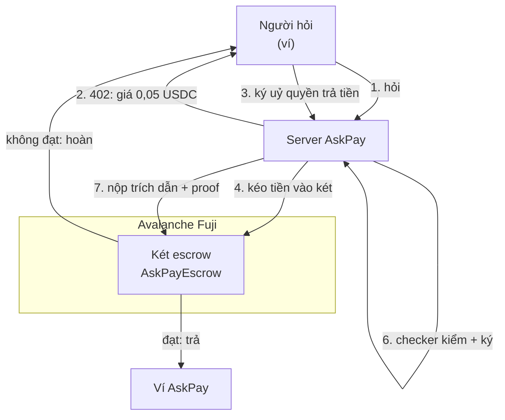

> **Nhập môn khái niệm cho người mới.** Đây không phải spec kỹ thuật. Khi lệch với [`../architecture/`](../architecture/), bản trong `architecture/` thắng. File này chỉ giải thích *"đây là cái gì, vì sao có mặt, nối với cái gì"*. Chi tiết ở [`system-design.md`](../architecture/system-design.md), [`contracts.md`](../architecture/contracts.md), [`api.md`](../architecture/api.md).

# 🎓 AskPay — Nhập môn khái niệm (đọc 30–40 phút)

## Cách đọc file này

Các khái niệm xếp thành **10 cụm**, mỗi cụm trả lời một câu hỏi và **dẫn sang cụm sau**:

```
Cụm 1: Blockchain nền tảng          → "tiền nằm ở đâu, ai ký được?"
Cụm 2: Vấn đề: AI bịa luật          → "vì sao cần AskPay?"
Cụm 3: x402                         → "trả tiền cho một lần gọi API thế nào?"
Cụm 4: Ký uỷ quyền (EIP-712, 3009)  → "trả tiền mà không tự gửi giao dịch?"
Cụm 5: Escrow                       → "giữ tiền tới khi kiểm xong"
Cụm 6: Merkle tree                  → "chứng minh một Khoản có thật mà không đưa cả bộ luật lên chain"
Cụm 7: RAG và LLM                   → "AI tìm và viết câu trả lời ra sao?"
Cụm 8: Checker                      → "ai xác nhận câu trả lời đạt?"
Cụm 9: 5 nguyên tắc P1–P5           → "luật sống còn của hệ thống"
Cụm 10: Ghép lại                    → "theo dấu 2 câu hỏi từ đầu đến cuối"
```

Mỗi khái niệm có cùng khuôn: **Là gì** → **Liên tưởng** → **Trong AskPay**. Cuối mỗi cụm có câu hỏi tự kiểm tra.

**Số dùng xuyên suốt (giá trị demo):** giá một câu **0,05 USDC** = `50000` đơn vị nhỏ nhất (USDC có 6 số lẻ). Thời hạn trả lời **10 phút**. Bộ luật có **220 Điều**.

---

## 0. Bản đồ tổng thể



**Câu chuyện trong một đoạn:** Bạn hỏi. Server báo giá. Bạn ký một tờ "uỷ quyền chuyển 0,05 USDC vào két". Server dùng tờ uỷ quyền đó kéo tiền vào **két trên blockchain**. AI tìm các Khoản liên quan và viết câu trả lời có trích dẫn. Bộ kiểm tra xác nhận và ký. Server nộp trích dẫn kèm "giấy chứng nhận" (Merkle proof) cho két. Két tự kiểm: trích dẫn thật thì trả tiền cho AskPay; giả hoặc không có thì trả lại bạn. Server im lặng quá 10 phút thì bạn tự rút tiền về.

---

## Cụm 1 — Blockchain nền tảng

*Câu hỏi: tiền nằm ở đâu và ai được chuyển nó?*

| Khái niệm | Là gì | Liên tưởng | Trong AskPay |
|---|---|---|---|
| **Blockchain** | Sổ cái dùng chung, ghi nối tiếp, không sửa được | Sổ kế toán công khai, ai cũng có bản sao | Nơi két escrow và tiền tồn tại |
| **Avalanche Fuji** | Mạng thử nghiệm của Avalanche C-Chain (chain id `43113`) | Sân tập: giống thật nhưng tiền là tiền thử | Toàn bộ demo chạy ở đây |
| **Ví / EOA** | Tài khoản do một private key điều khiển | Tài khoản ngân hàng mà ai có mật khẩu là toàn quyền | Ví người hỏi, ví provider, ví owner |
| **Private key** | Chuỗi bí mật dùng để ký | Mật khẩu và con dấu gộp làm một. **Lộ là mất tiền.** | Khoá provider và khoá checker chỉ nằm trong `.env` |
| **Transaction (tx)** | Lệnh đã ký gửi lên mạng để đổi sổ cái | Phiếu chuyển tiền có chữ ký | `deposit`, `settle`, `claimRefund` |
| **Gas / AVAX** | Phí xử lý tx, trả bằng AVAX | Phí chuyển khoản | Ví provider cần AVAX để gửi `deposit` và `settle` |
| **USDC** | Stablecoin 1 USDC ≈ 1 USD, phát hành bởi Circle | Tiền điện tử neo theo đô la | Đơn vị trả cho mỗi câu hỏi |
| **Smart contract** | Chương trình chạy trên chain, ai cũng đọc được mã, không ai sửa được khi đã deploy | Máy bán hàng tự động: bỏ tiền đúng điều kiện thì ra hàng | `AskPayEscrow` |
| **Event** | Dòng nhật ký contract phát ra khi có thay đổi | Biên lai | `Deposited`, `Paid`, `Refunded` |
| **Snowtrace** | Trình xem blockchain của Avalanche | Tra cứu vận đơn | Mỗi tx trong UI có link Snowtrace |
| **Finality** | Thời điểm tx chắc chắn không bị đảo ngược | Tiền đã "về tài khoản" | Avalanche khoảng 1–2 giây |

**Tự kiểm tra:** Vì sao provider cần AVAX còn checker thì không? *(Provider gửi tx; checker chỉ ký dữ liệu off-chain.)*

## Cụm 2 — Vấn đề: AI bịa luật

*Câu hỏi: vì sao người dùng cần AskPay?*

- LLM viết rất trôi chảy nhưng hay **"ảo giác"**: bịa số Điều, gán nhầm nội dung giữa các Điều, hoặc dẫn luật đã hết hiệu lực.
- Người hỏi thường không đủ kiến thức để phát hiện. Hậu quả có thể thật: ký hợp đồng thử việc sai luật, mất quyền lợi khi nghỉ việc.
- Mô hình trả phí hiện nay (thuê bao tháng) thu tiền **bất kể câu trả lời đúng hay sai**.

AskPay đảo ngược điều này: **chỉ thu tiền khi câu trả lời có căn cứ kiểm chứng được**, và việc kiểm chứng được giao cho blockchain chứ không phải lời hứa của công ty.

**Tự kiểm tra:** AskPay có đảm bảo câu trả lời "đúng" 100% không? *(Không. Nó đảm bảo trích dẫn có thật và đúng nguyên văn; mức liên quan do checker đánh giá. Xem Cụm 8.)*

## Cụm 3 — x402: trả tiền qua HTTP

*Câu hỏi: làm sao trả tiền cho đúng một lần gọi API?*

| Khái niệm | Là gì | Liên tưởng | Trong AskPay |
|---|---|---|---|
| **HTTP 402 Payment Required** | Mã trạng thái HTTP có từ lâu nhưng ít dùng, nghĩa là "cần trả tiền" | Cổng soát vé: "vé 0,05 USDC" | Lần gọi `POST /api/ask` đầu tiên trả 402 |
| **x402** | Chuẩn mở dùng mã 402 để trả bằng stablecoin cho từng request | Quẹt thẻ cho từng lượt, không cần đăng ký thành viên | Giao thức thanh toán của AskPay |
| **`PAYMENT-REQUIRED`** | Header server gửi: giá, token, mạng, người nhận | Bảng giá dán ở cổng | Có `qid`, địa chỉ escrow |
| **`PAYMENT-SIGNATURE`** | Header client gửi lại kèm chữ ký trả tiền | Vé đã ký | Chứa uỷ quyền EIP-3009 |
| **`PAYMENT-RESPONSE`** | Header server trả kèm kết quả: tx đã thực hiện | Hoá đơn | Có hash tx deposit và settle |
| **Scheme** | Cách cụ thể để trả. `exact` = chuyển thẳng cho người bán | Hình thức thanh toán | AskPay dùng scheme **`escrow`**: tiền vào két, có thể hoàn |
| **Facilitator** | Bên kiểm chữ ký và gửi tx thay người bán | Máy POS của ngân hàng | Server AskPay tự làm |

**Vì sao không dùng `exact`?** Vì `exact` chuyển tiền thẳng cho người bán, không có đường hoàn. Lời hứa "trích sai thì hoàn tiền" cần một bên thứ ba trung lập giữ tiền, tức là két escrow.

**Tự kiểm tra:** Ở lần gọi đầu tiên, người hỏi đã mất tiền chưa? *(Chưa. 402 chỉ là báo giá.)*

## Cụm 4 — Ký uỷ quyền: EIP-712 và EIP-3009

*Câu hỏi: làm sao trả tiền mà người hỏi không phải tự gửi giao dịch?*

| Khái niệm | Là gì | Liên tưởng | Trong AskPay |
|---|---|---|---|
| **EIP-712** | Chuẩn ký dữ liệu có cấu trúc, ví hiển thị rõ từng trường cho người dùng đọc | Ký vào một mẫu đơn in sẵn các ô, thay vì ký vào giấy trắng | Ví hiện "chuyển 0,05 USDC tới AskPayEscrow, hạn …" |
| **Domain** | Phần "tiêu đề" của chữ ký EIP-712: tên, phiên bản, chain, contract | Tên cơ quan in trên mẫu đơn | Chữ ký cho Fuji không dùng được ở mạng khác |
| **EIP-3009** | Chuẩn token cho phép chuyển tiền bằng **chữ ký** thay vì tx | Séc đã ký: ai cầm séc đi lĩnh tiền | USDC hỗ trợ chuẩn này |
| **`ReceiveWithAuthorization`** | Biến thể EIP-3009: **chỉ người nhận** mới được dùng chữ ký để kéo tiền | Séc gạch chéo: chỉ người có tên trên séc mới lĩnh được | Chỉ escrow kéo được tiền, nên không ai chặn trước được (front-run) |
| **Nonce** | Số dùng một lần để chữ ký không bị dùng lại | Số seri của séc | **`nonce = qid`**: tiền gắn chặt với đúng câu hỏi |

**Tự kiểm tra:** Nếu ai đó chép được chữ ký của bạn, họ có rút tiền vào ví họ được không? *(Không. `to` là escrow, chỉ escrow được gọi `receiveWithAuthorization`, và nonce chỉ dùng một lần.)*

## Cụm 5 — Escrow: két giữ hộ

*Câu hỏi: ai giữ tiền trong lúc AI trả lời và kiểm tra?*

| Khái niệm | Là gì | Trong AskPay |
|---|---|---|
| **Escrow** | Bên trung gian giữ tiền tới khi điều kiện được thoả | Contract `AskPayEscrow` |
| **`deposit`** | Kéo tiền từ ví người hỏi vào két, ghi `qid` ở trạng thái `Open` | Provider gọi |
| **`settle`** | Nộp kết quả: trích dẫn, proof, chữ ký checker. Két quyết định Paid hay Refunded | Provider gọi |
| **`claimRefund`** | Rút tiền về khi quá hạn mà chưa ai chốt | Bất kỳ ai gọi; tiền luôn về người hỏi |
| **Provider** | Bên bán câu trả lời, nhận tiền khi đạt | Ví server AskPay |
| **Owner** | Người deploy và đăng ký bộ luật | Akira. **Không rút được tiền đang giữ.** |
| **Lý do hoàn tiền** | `NO_CITATION`, `INVALID_CITATION`, `CHECKER_REJECTED`, `ANSWER_FAILED`, `TIMEOUT` | Hiện trên UI bằng câu tiếng Việt |

**Tự kiểm tra:** Server sập ngay sau khi giữ tiền thì sao? *(10 phút sau, người hỏi bấm "Nhận lại tiền", gọi `claimRefund` thẳng từ ví.)*

## Cụm 6 — Merkle tree: chứng minh một Khoản có thật

*Câu hỏi: làm sao contract biết Khoản 2 Điều 25 có thật, mà không cần lưu cả bộ luật trên chain?*

**Ví dụ thu nhỏ với 4 Khoản (A, B, C, D):**

```
                 ROOT = H(H_AB, H_CD)          ← chỉ lưu cái này trên chain (32 byte)
                /                    \
        H_AB = H(hA, hB)        H_CD = H(hC, hD)
         /        \               /        \
       hA          hB           hC          hD   ← leaf: băm (Điều, Khoản, nguyên văn)
```

Muốn chứng minh **C** có trong cây, chỉ cần đưa `hD` và `H_AB` (gọi là **proof**). Contract tính `H(H(hC, hD), H_AB)` rồi so với ROOT. Khớp thì C có thật. Sửa C dù một dấu phẩy thì hash đổi và không còn khớp.

| Khái niệm | Trong AskPay |
|---|---|
| **Leaf** | Băm của `(lawId, Điều, Khoản, hash nguyên văn đã chuẩn hoá)` |
| **Root** | Đăng ký on-chain bằng `setLawRoot`; khoảng 1.000 Khoản → proof dài khoảng 10 hash |
| **Chuẩn hoá** | Unicode NFC + gộp khoảng trắng, để cùng một chữ luôn cho cùng một hash |
| **Ai cũng kiểm được** | Corpus và script nằm trong repo: chạy lại sẽ ra đúng root đang on-chain |

**Tự kiểm tra:** Nếu AI trích "Điều 25 Khoản 5" mà Điều 25 chỉ có 4 Khoản thì sao? *(Không có leaf nào như vậy nên không có proof hợp lệ. Thực tế AI còn không chọn được, vì nó chỉ được trích trong danh sách ứng viên.)*

## Cụm 7 — RAG và LLM

*Câu hỏi: AI tìm và viết câu trả lời ra sao?*

| Khái niệm | Là gì | Liên tưởng | Trong AskPay |
|---|---|---|---|
| **LLM** | Mô hình ngôn ngữ lớn | Người viết giỏi nhưng hay nói quá | Viết câu trả lời tiếng Việt |
| **RAG** | Tìm tài liệu liên quan trước, rồi đưa cho LLM viết dựa trên đó | Mở sách ra rồi mới trả lời | Lấy 8 Khoản liên quan nhất |
| **BM25** | Thuật toán xếp hạng văn bản theo từ khoá, không cần AI | Tìm kiếm trong mục lục | Bước tìm Khoản |
| **Constrained output** | Ép LLM trả theo khuôn JSON, chỉ được chọn trong danh sách cho sẵn | Bài trắc nghiệm thay vì tự luận | LLM chỉ được trích ID `C1…C8` |
| **`noBasis`** | LLM báo không có căn cứ | "Câu này không có trong sách" | Câu ngoài phạm vi → không trích dẫn → hoàn tiền |

## Cụm 8 — Checker

*Câu hỏi: ai xác nhận câu trả lời "đạt"?*

Checker chạy bốn bước, dừng ở bước đầu tiên không đạt:

1. **C1:** có trích dẫn không?
2. **C2:** đoạn trích có nằm nguyên văn trong Khoản không? *(so chuỗi)*
3. **C3:** câu trả lời có nhắc Điều nào ngoài các Điều đã trích không? *(regex)*
4. **C4:** Khoản được trích có thật sự trả lời câu hỏi không? *(LLM chấm có/không)*

Sau đó checker **ký kết luận** bằng EIP-712 với **khoá riêng**, khác khoá của provider. Contract chỉ chấp nhận chữ ký của đúng địa chỉ checker đã đăng ký.

**Phân vai:** checker kiểm *nội dung* (khớp nguyên văn, có liên quan); chain kiểm *tính xác thực* (Khoản có thật, nguyên văn không bị sửa). Checker sai thì chain vẫn chặn trích dẫn giả.

## Cụm 9 — 5 nguyên tắc cần nhớ (P1–P5)

| # | Nguyên tắc | Nhớ bằng câu |
|---|---|---|
| P1 | Tiền chỉ về người hỏi hoặc provider | "Két chỉ có hai cửa." |
| P2 | Chain là nguồn sự thật | "Lệch thì tin chain." |
| P3 | AI không chạm vào tiền | "AI viết, code quyết." |
| P4 | Trích dẫn phải chứng minh được | "Không proof, không tiền." |
| P5 | Không bao giờ kẹt tiền | "Quá hạn thì tự rút." |

## Cụm 10 — Ghép lại: hai câu chuyện

### Câu chuyện A: câu hỏi hợp lệ → Paid

1. Lan gõ: *"Thử việc tối đa bao lâu nếu công việc cần bằng cao đẳng?"* Server tạo `qid = 0x9f…` và trả 402, giá `50000`.
2. Ví Lan hiện mẫu ký: chuyển 0,05 USDC tới AskPayEscrow, nonce `0x9f…`. Lan ký.
3. Server kiểm chữ ký rồi gọi `deposit`. Két kéo 0,05 USDC từ ví Lan; event `Deposited`, hạn chốt là 10 phút sau.
4. BM25 lấy 8 Khoản; Điều 25 Khoản 2 đứng đầu. LLM trả JSON: "không quá 60 ngày…", trích `C1`.
5. Checker: C1 có trích dẫn; C2 đoạn trích nằm trong nguyên văn; C3 chỉ nhắc Điều 25; C4 liên quan. Ký `pass = true`.
6. Server gọi `settle` kèm proof. Két kiểm chữ ký checker, kiểm proof khớp root, rồi chuyển 0,05 USDC cho provider; event `Paid`.
7. Trang kết quả hiện ĐÃ THANH TOÁN, thẻ trích dẫn có ✓, link Snowtrace.

### Câu chuyện B: server bị ép trích bịa → Refunded

1. Như trên đến bước 4, nhưng ở chế độ demo, `textHash` của trích dẫn bị thay bằng hash bịa trước khi gửi cho checker.
2. Checker chỉ kiểm nội dung nên vẫn ký `pass = true` (giả lập checker cũng sai).
3. Két kiểm chữ ký: hợp lệ. Kiểm proof: **không khớp root**. Két chuyển 0,05 USDC **về ví Lan**; event `Refunded(INVALID_CITATION)`.
4. Kết luận: dù cả server lẫn checker đều sai, **chain vẫn chặn**.

### Đọc tiếp theo vai trò

| Bạn muốn | Đọc |
|---|---|
| Thuyết trình | [`../product/pitch.md`](../product/pitch.md) |
| Viết contract | [`../architecture/contracts.md`](../architecture/contracts.md) |
| Viết API | [`../architecture/system-design.md`](../architecture/system-design.md), [`../architecture/api.md`](../architecture/api.md) |
| Viết giao diện | [`../product/ui-pages.md`](../product/ui-pages.md), [`../product/design-system.md`](../product/design-system.md) |

---

## Phụ lục — Từ điển nhanh (A–Z)

| Thuật ngữ | Nghĩa ngắn | Cụm |
|---|---|---|
| `answerWindow` | Thời hạn trả lời (10 phút) trước khi được tự rút tiền | 5 |
| BM25 | Thuật toán xếp hạng theo từ khoá | 7 |
| Checker | Bộ kiểm tra có khoá ký riêng | 8 |
| `citationsHash` | Băm danh sách trích dẫn, nằm trong chữ ký checker | 8 |
| `claimRefund` | Hàm tự rút tiền khi quá hạn | 5 |
| Corpus | Bộ luật đã tách thành Khoản | 6 |
| `deposit` | Hàm kéo tiền vào két | 5 |
| EIP-3009 | Chuyển token bằng chữ ký | 4 |
| EIP-712 | Chuẩn ký dữ liệu có cấu trúc | 4 |
| Escrow | Két giữ hộ | 5 |
| Event | Nhật ký contract | 1 |
| Facilitator | Bên kiểm chữ ký và gửi tx thanh toán | 3 |
| Finality | Thời điểm tx không thể đảo ngược | 1 |
| Fuji | Testnet của Avalanche, chain id 43113 | 1 |
| Khoản | Đơn vị trích dẫn của AskPay | 6 |
| `lawId` | Mã định danh một phiên bản bộ luật | 6 |
| Leaf | Băm của một Khoản | 6 |
| Merkle proof | Chuỗi hash chứng minh leaf thuộc cây | 6 |
| Nonce | Số dùng một lần; ở AskPay `nonce = qid` | 4 |
| `noBasis` | LLM báo không có căn cứ | 7 |
| Provider | Bên bán câu trả lời | 5 |
| `qid` | Mã câu hỏi (32 byte) | 3, 4 |
| RAG | Tìm tài liệu rồi mới viết | 7 |
| `ReceiveWithAuthorization` | Uỷ quyền chỉ người nhận được dùng | 4 |
| Root | Gốc cây Merkle, lưu on-chain | 6 |
| Scheme | Cách trả trong x402 (`exact`, `escrow`) | 3 |
| `settle` | Hàm chốt Paid/Refunded | 5 |
| Snowtrace | Trình xem blockchain Avalanche | 1 |
| Verdict | Kết luận đã ký của checker | 8 |
| x402 | Chuẩn trả tiền qua HTTP 402 | 3 |
