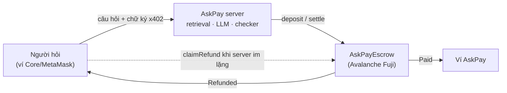

# ASKPAY: HỎI LUẬT TRẢ THEO CÂU, TRÍCH SAI THÌ HOÀN TIỀN

> Bản đơn giản hoá để thuyết trình và trả lời giám khảo. **Không dùng làm spec.** Khi lệch nhau, [spec](../spec/askpay-v1.md) và [system-design](../architecture/system-design.md) thắng.

## 1. Hiểu nhanh trong 2 phút

**Một câu:** AskPay là AI trả lời câu hỏi về Bộ luật Lao động. Bạn trả khoảng 1.300đ cho mỗi câu qua x402 trên Avalanche, và **chỉ mất tiền khi trích dẫn Điều/Khoản qua được kiểm tra của smart contract.**

**Ví dụ đời thường.** Bạn đi làm thêm và muốn biết công ty được bắt thử việc bao lâu.
- Hỏi chatbot thường: nó trả lời "theo Điều 27, tối đa 6 tháng", nghe rất tự tin nhưng sai cả số Điều lẫn nội dung.
- Hỏi AskPay: bạn ký trả 0,05 USDC. Tiền vào một "két giữ hộ" trên blockchain. AI trả lời và **bắt buộc dẫn nguyên văn Khoản 2 Điều 25**. Két tự kiểm tra Khoản đó có thật và đúng nguyên văn hay không. Đúng thì két trả tiền cho AskPay. Sai hoặc không dẫn được căn cứ thì két **tự trả tiền lại cho bạn**.

**Từ điển cho người mới:**

| Từ | Nghĩa ngắn |
|---|---|
| x402 | Chuẩn "trả tiền qua HTTP": server trả mã 402 kèm giá, client ký trả rồi gửi lại |
| Escrow | Két giữ hộ: giữ tiền tới khi điều kiện được kiểm xong |
| Merkle proof | "Giấy chứng nhận" ngắn chứng minh một Khoản nằm trong bộ luật đã đăng ký, không cần đưa cả bộ luật lên chain |
| Checker | Bộ kiểm tra độc lập (khoá riêng) xác nhận đoạn trích đúng nguyên văn và liên quan tới câu hỏi |
| Fuji | Mạng thử nghiệm của Avalanche |

## 2. Tiêu chí chấm điểm và cách AskPay đạt

| Tiêu chí | Điểm | AskPay đáp ứng bằng | Bằng chứng khi demo |
|---|---|---|---|
| Kỹ thuật | 25 | Escrow + EIP-3009 `ReceiveWithAuthorization` + Merkle proof + chữ ký EIP-712 của checker; invariant/fuzz test Foundry; RAG có ràng buộc; bộ eval có số liệu | Chiếu `forge test`, kết quả eval |
| Tích hợp Avalanche | 25 | Mọi khoản tiền và kết luận nằm on-chain trên Fuji; x402 với scheme `escrow` mới; dùng USDC/EIP-3009; finality nhanh và phí thấp làm micropayment khả thi | Link Snowtrace cho từng tx, contract đã verify |
| Sáng tạo | 15 | "Trích sai thì hoàn tiền"; xác minh trích dẫn pháp luật bằng Merkle proof (chưa thấy ai làm cho luật Việt Nam) | Bước "trích bịa bị chain từ chối" |
| Tác động | 15 | Sinh viên đi làm thêm và người lao động tra quyền lợi với giá vài nghìn đồng; mở rộng được sang luật khác | Câu hỏi thật của sinh viên |
| Thuyết trình | 10 | Kịch bản 3 phút cố định ([demo.md](../runbook/demo.md)) | — |
| UI/UX & demo | 10 | Timeline từng bước, thẻ trích dẫn có dấu xác minh, trạng thái Paid/Refunded rõ ràng | — |

## 3. Input → Process → Output qua ví dụ

| | Câu hợp lệ | Câu ngoài phạm vi | Trích bịa (demo) |
|---|---|---|---|
| **Input** | "Thử việc tối đa bao lâu nếu cần bằng cao đẳng?" | "Nồng độ cồn bao nhiêu thì bị phạt?" | "#demo-fake Làm thêm giờ tối đa bao nhiêu?" |
| **Trả tiền** | 0,05 USDC vào escrow | 0,05 USDC vào escrow | 0,05 USDC vào escrow |
| **AI** | Trích Điều 25 Khoản 2 | `noBasis`: không có căn cứ | Trích Điều 107 nhưng hash bị bịa |
| **Checker** | Đạt, ký `pass = true` | Không cần (không có trích dẫn) | Đạt (giả lập checker cũng sai; kiểm hash là việc của chain) |
| **Contract** | Proof khớp → **Paid** | Không có trích dẫn → **Refunded** `NO_CITATION` | Proof không khớp → **Refunded** `INVALID_CITATION` |
| **Output** | Câu trả lời + ✓ + link tx | "Không có căn cứ" + tiền về ví | Cảnh báo + tiền về ví |

## 4. Sơ đồ kiến trúc

Chi tiết: [system-design §2](../architecture/system-design.md#2-kiến-trúc-tổng-thể).

## 5. Logic cụ thể

### 5.1 Contract quyết định trả hay hoàn (4 câu hỏi liên tiếp)

1. Có trích dẫn không? Không → hoàn tiền `NO_CITATION`.
2. Chữ ký checker có đúng khoá checker không? Không → **từ chối lệnh**, tiền vẫn giữ.
3. Mọi trích dẫn có Merkle proof khớp bộ luật đã đăng ký không? Có một cái sai → hoàn tiền `INVALID_CITATION`.
4. Checker kết luận đạt không? Không → hoàn tiền `CHECKER_REJECTED`. Có → **trả cho provider**.

Thêm một lối thoát: quá 10 phút chưa chốt → người hỏi tự gọi `claimRefund`.

### 5.2 Đâu là AI, đâu là code

| Phần | Là gì | Có quyền với tiền không |
|---|---|---|
| Retrieval | BM25, thuần toán | Không |
| Answer | LLM, bị ép trả JSON và chỉ được trích Khoản có trong danh sách | Không |
| Checker C1–C3 | Code tất định (so chuỗi, regex) | Không |
| Checker C4 | LLM chấm mức liên quan | Không; chỉ ra `yes`/`no`, code ký |
| Escrow | Smart contract | **Có, và là phần duy nhất có** |

## 6. 12 câu hỏi giám khảo hay hỏi

1. **"Server vừa là provider vừa là checker, vậy có gian lận được không?"** Checker dùng khoá khác, và contract từ chối nếu hai khoá trùng. Phần chain đảm bảo tuyệt đối là **trích dẫn có thật và đúng nguyên văn**; trích bịa thì không qua được dù server có muốn. Phần "liên quan hay không" ở v1 vẫn phải tin checker. Roadmap là checker độc lập có stake. Chúng tôi nói thẳng giới hạn này ([system-design §11](../architecture/system-design.md#11-giới-hạn-đã-biết)).
2. **"Sao không đưa cả bộ luật lên chain?"** Khoảng 1.000 Khoản sẽ tốn rất nhiều gas. Merkle root chỉ 32 byte; mỗi proof khoảng 10 hash.
3. **"Đây có phải x402 thật không?"** Đúng giao thức x402 v2 (mã 402, header `PAYMENT-REQUIRED`, `PAYMENT-SIGNATURE`, `PAYMENT-RESPONSE`), nhưng dùng scheme `escrow` mới thay cho `exact`, vì `exact` không hoàn tiền được.
4. **"Người dùng lợi dụng hỏi câu ngoài phạm vi để dùng miễn phí?"** Câu ngoài phạm vi chỉ nhận được "không có căn cứ", không có nội dung gì đáng giá. Server chỉ tốn một lần gọi LLM, và báo giá có giới hạn tần suất.
5. **"Luật sửa đổi thì sao?"** Mỗi phiên bản luật có `lawId` và root riêng. Câu trả lời cũ vẫn gắn với root cũ nên vẫn kiểm chứng được.
6. **"AI trả lời sai ý dù trích đúng Khoản?"** Checker C4 bắt phần lớn trường hợp này. Bộ eval đo tỉ lệ. Disclaimer nói rõ đây không phải tư vấn pháp lý.
7. **"Sao chọn Avalanche?"** Finality khoảng 1–2 giây và phí thấp. Micropayment 1.300đ chỉ hợp lý khi phí gas nhỏ hơn nhiều lần.
8. **"Tiền có bị kẹt trong contract không?"** Không. Quá hạn thì ai cũng gọi được `claimRefund`, tiền về đúng người hỏi. Có invariant test cho điều này.
9. **"Chủ contract có rút được tiền của người dùng không?"** Không. Contract không có hàm rút tuỳ ý (P1).
10. **"Sao không dùng facilitator có sẵn?"** Facilitator công khai chỉ hỗ trợ `exact`. Escrow cần server tự gọi `deposit` và `settle`.
11. **"Mô hình kinh doanh?"** Thu theo câu; mở cho nhiều provider cùng bán câu trả lời trên một chuẩn kiểm chứng chung; agent khác (chatbot, ứng dụng HR) gọi qua x402.
12. **"Đo chất lượng thế nào?"** Bộ eval khoảng 50 câu có nhãn, đo 3 chỉ số: trích đúng Khoản, tỉ lệ đạt checker, tỉ lệ nhận diện đúng câu ngoài phạm vi.

## 7. Phân công và demo

Làm một mình. Lộ trình ở [plan.md](../runbook/plan.md). Kịch bản 3 phút ở [demo.md](../runbook/demo.md).

**Thông điệp kết:** *"Trích sai thì hoàn tiền, và chính blockchain xác nhận điều đó."*
